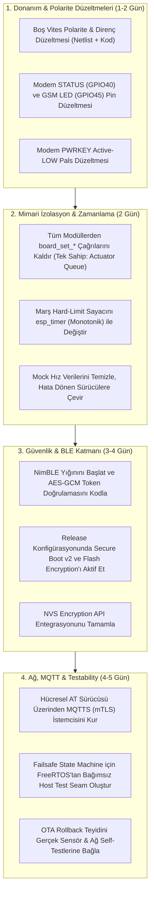

# AutoMoto — Kapsamlı Firmware İskeleti Analiz ve Risk Raporu (T7 Sentezi)

**Belge Sürümü:** 1.0 (Konsolide Ana Rapor)  
**Tarih:** 26 Ekim 2026  
**Kapsam:** ESP32-S3 Firmware İskeleti (`firmware/`), Donanım Şematiği/Netlist (`hardware/`), Simülasyon Altyapısı (`sim/`)  
**Metodoloji:** 6 Bağımsız Açıdan Çapraz Denetim (OpenCode Teamwork mimarisi ve karşılıklı doğrulama)

> [!NOTE]
> Bu sentez raporu; [01-architecture.md](file:///home/sorcnr/Documents/automoto/docs/analysis/01-architecture.md), [02-safety.md](file:///home/sorcnr/Documents/automoto/docs/analysis/02-safety.md), [03-security.md](file:///home/sorcnr/Documents/automoto/docs/analysis/03-security.md), [04-build-config.md](file:///home/sorcnr/Documents/automoto/docs/analysis/04-build-config.md), [05-hardware-pinmap.md](file:///home/sorcnr/Documents/automoto/docs/analysis/05-hardware-pinmap.md) ve [06-testability.md](file:///home/sorcnr/Documents/automoto/docs/analysis/06-testability.md) olmak üzere altı bağımsız teknik analiz raporunun sentezlenmesiyle oluşturulmuştur.

---

## 1. Yönetici Özeti (Executive Summary)

AutoMoto firmware iskeleti; **dokümantasyonu son derece güçlü, mimari niyetleri ve sınırları doğru çizilmiş, ancak henüz fonksiyonel davranışları birbirine bağlanmamış (unwired) bir temel yapıdadır.**

Tüm kritik güvenlik ve emniyet fonksiyonları (`actuator_safety`, `failsafe`, `ble_keyless`, `power_manager`, `modem`) C kodunda derlenebilir durumdadır; ancak **neredeyse sıfır çağıranı (zero-callers)** bulunmaktadır. Dolayısıyla şu anki haliyle yazılım motoru çalıştıramaz, marş basamaz veya kontağı otonom yönetemez. Bu durum saha güvenliği açısından ölümcül bir kazaya yol açmayacağı için olumlu, ancak ürün olgunluğu açısından henüz yolun başında olunduğunu gösteren kritik bir tablodur.

---

## 2. Konsolide Risk Kütüğü (Risk Register)

### 2.1. P0 — Can Güvenliği ve Seri Üretim Engelleyici Kritik Riskler (Ship-Blockers)

| ID | Risk Tanımı | Etki ve Açıklama | Kaynak Rapor |
|---|---|---|---|
| **P0-1** | **Boş Vites (Neutral) Sinyalinde Ters Polarite (Fail-Unsafe)** | Netlistte U9 optokuplör emitter-follower çıkışı harici **R14 10 kΩ pull-down** ile şaseye çekilmiştir. Firmware ise dahili pull-up varsayarak `GPIO12 == LOW` durumunu "Boşta" (Neutral) kabul eder. **Kablo koptuğunda, soket çıktığında veya araç vitesteyken GPIO12 LOW okunur; sistem motoru vitesteyken marşlar.** | F-05-01 / F-02-01 |
| **P0-2** | **Secure Boot v2 Konfigürasyonda Kapalı** | `partitions.csv` içinde 48 KB bootloader marjı açılmıştır ancak `firmware/sdkconfig.defaults` içinde `CONFIG_SECURE_BOOT_V2_ENABLED` bayrağı aktif değildir. Koltuğu açan bir saldırgan 2 dakikada karta sahte firmware yükleyebilir. | F-04-01 / F-03-01 |
| **P0-3** | **Flash Encryption Kapalı (Etkisiz Şifreleme)** | `nvs_keys` ve `storage` için `partitions.csv`'deki `encrypted` bayrakları, `CONFIG_SECURE_FLASH_ENC_ENABLED` açılmadığı sürece donanımsal olarak çalışmaz; flaş bellek sökülüp okunabilir. | F-04-02 / F-03-01 |
| **P0-4** | **BLE Keyless Doğrulama Stub Aşamasında** | `ble_keyless_verify_challenge_response()` fonksiyonu yalnızca 18 ms RTT süresini denetler. Gelen `response` ve `len` parametreleri okunmaz, dinamik AES-GCM token doğrulaması yapılmadan kontak açılır. | F-03-02 / F-06-01 |
| **P0-5** | **Aktüatör Tek-Sahiplik İlkesinin İhlali** | `actuator_safety.c` mimarisi kurulmuş olmasına rağmen; `failsafe.c`, `ble_keyless.c:52` ve `power_manager.c:46` doğrudan `board_pins.c` GPIO fonksiyonlarını çağırmaktadır. TWDT denetimli kuyruk mimarisi bypass edilmektedir. | F-01-01 / F-02-03 |
| **P0-6** | **Emniyet Kontrol Yolları Çağrılmıyor (Unreachable)** | `failsafe_trigger_soft_kill`, `actuator_request_*`, `ble_keyless_verify_challenge_response` ve `power_manager_enter_deep_sleep` fonksiyonlarını periyodik görevlerden tetikleyen hiçbir çağıran yoktur. | F-01-04 |
| **P0-7** | **LIS3DH Sarsıntı / Sabotaj Hattı İşlevsiz** | `sensors_imu_read_accel()` fonksiyonu GPIO4'ü okur ancak GPIO4 hiçbir zaman input olarak konfigüre edilmemiştir ve LIS3DH I2C kayıtları (INT1 eşik registerları) başlatılmamıştır. Hırsızlık alarmı sessiz kalır. | F-05-02 / F-02-13 |

---

### 2.2. P1 — Üretim Öncesi Düzeltilmesi Zorunlu Riskler (High Priority)

1. **Hızdan Bağımsız Kör Soft-Kill (Speed-Blind Motor Durdurma):**  
   `failsafe.c` içindeki 3 aşamalı motor durdurma; sabit zaman döngüsüne (3 sn puls $\to$ 2 sn siren $\to$ kontak kesme) sahiptir. Motosikletin 100 km/h hızda mı yoksa 0 km/h hızda mı olduğu denetlenmemektedir. Seyir halinde ölümcül kaza riski doğurur (`SECURITY_SPECIFICATION.md:134-138` ihlali).
2. **Hız Kaynağının Bulunmaması (Mock Data Riski):**  
   `modem.c` içindeki GNSS hız değeri `0.0` olarak hard-code edilmiştir; `sensors_imu.c` sabit değerler döner. Sisteme "hız < 20 km/h olmadan kontağı kesme" kuralı konsa dahi sahte veriler yüzünden anında kontak kesilecektir.
3. **Marş Hard-Limitinin Monotonik Timer Olmaması:**  
   `actuator_safety.c` içindeki marş 1500 ms sayacı, task döngüsünde 20 ms'lik düşümlerle çalışmaktadır. CPU yük altında task gecikirse marş süresi 2000-3000 ms'ye uzayabilir. Mutlak `esp_timer_get_time()` zaman damgası kullanılmalıdır.
4. **Hücresel Modem STATUS ve PWRKEY Uyuşmazlığı:**  
   - Firmware'de GPIO21 STATUS olarak tanımlıdır; ancak netlistte GPIO21 modemin RI (Ring Indicator) bacağına bağlıdır.
   - Modemin PWRKEY pals mantığı donanımda Active-LOW iken kodda Active-HIGH tetiklenmektedir.
5. **PROFET Akım Algılama (IS) Korumasızlığı:**  
   `PIN_PROFET_IS` (GPIO10) ADC hattı firmware'de okunmamaktadır. Ayrıca donanımda şönt üzerinde aşırı gerilim klamplama diyotu (zener/TVS) bulunmadığından arıza durumunda ESP32 pinine aşırı gerilim binebilir.
6. **OTA Rollback Test Eksikliği:**  
   `main.c` içindeki `esp_ota_mark_app_valid_cancel_rollback()` fonksiyonu açılışta donanım ve modem testleri yapılmadan çağrılmaktadır; hatalı bir firmware de kendini "sağlam" olarak işaretleyip geri dönüşü kilitleyebilir.
7. **NVS Şifrelemesiz Açık Metin Depolama:**  
   Cihaz sertifikaları ve cihaz anahtarları şifrelenmemiş NVS alanında saklanmaktadır (`nvs_keys` partition'ı tanımlı olsa da kodda NVS Encryption API'si kullanılmamıştır).

---

## 3. Donanım ve Pin Haritası Çapraz Karşılaştırma Matrisi

Firmware tanımları (`board_pins.h`), PCB Spesifikasyonu (`PCB_SPECIFICATION.md`) ve KiCad Şematik Üreticisi (`generate_kicad_sch.py`) arasındaki eşleşmeler:

| Pin Adı | Firmware (`board_pins.h`) | PCB Dokümanı | KiCad Netlist (`sch.py`) | Durum / Çatışma Analizi |
| :--- | :--- | :--- | :--- | :--- |
| **I2C_SDA / SCL** | GPIO 1 / 2 | GPIO 1 / 2 | GPIO 1 / 2 |  **Tam Uyumlu** (Pull-up dirençleri mevcut) |
| **SSR_KILL** | GPIO 3 | GPIO 3 | GPIO 3 | ⚠️ **Strapping Pini:** Boot anında lojik durumu işlemciyi etkileyebilir |
| **IMU_INT1** | GPIO 4 | GPIO 4 | GPIO 4 | ⚠️ **Eksik Konfig:** Firmware'de input olarak tanımlanmamış |
| **IMU_INT2** | GPIO 5 | GPIO 5 | GPIO 5 |  **Uyumlu** |
| **PROFET_IN** | GPIO 8 | GPIO 8 | GPIO 8 |  **Uyumlu** |
| **SSR_STARTER** | GPIO 9 | GPIO 9 | GPIO 9 |  **Uyumlu** |
| **PROFET_IS** | GPIO 10 | GPIO 10 | GPIO 10 | ⚠️ **Eksik Kod:** ADC okuyucusu yazılmamış |
| **SIREN_CTRL** | GPIO 11 | GPIO 11 | GPIO 11 |  **Uyumlu** |
| **SENSE_NEUTRAL**| GPIO 12 | GPIO 12 | GPIO 12 | ❌ **Polarite Çatışması:** Kod Active-LOW, Netlist R14 Pull-Down ile Active-HIGH |
| **PROFET_DEN** | GPIO 15 | GPIO 15 | GPIO 15 |  **Uyumlu** |
| **MODEM_TX / RX**| GPIO 17 / 18 | GPIO 17 / 18 | GPIO 17 / 18 |  **Uyumlu** (UART1) |
| **MODEM_STATUS** | GPIO 21 | GPIO 21 | GPIO 40 (Netlist) | ❌ **Pin Kayması:** Netlistte GPIO21 = RI, GPIO40 = STATUS |
| **MODEM_PWRKEY** | GPIO 38 | GPIO 38 | GPIO 38 | ⚠️ **Pals Tersliği:** Kodda HIGH, SIM808'de LOW tetikleme gerekir |
| **LED_GSM** | GPIO 46 | GPIO 46 | GPIO 45 (Netlist) | ❌ **Pin Kayması:** Netlistte LED3 GPIO45'e bağlı, GPIO46 boşta (NC) |
| **LED_ALARM / BLE**| GPIO 47 / 48 | GPIO 47 / 48 | GPIO 47 / 48 |  **Uyumlu** |

---

## 4. Güvenlik Şartnamesi Uyum Analizi (`SECURITY_SPECIFICATION.md`)

| Güvenlik Alanı | Şartname Maddesi | Mevcut Durum | Eylemler |
| :--- | :--- | :---: | :--- |
| **BLE Anti-Relay** | $RTT \le 18\text{ ms}$ & AES-GCM | 🟡 Kısmi | Zaman ölçümü var, negatif RTT koruması ve token doğrulaması eksik |
| **BLE Güvenliği** | Apache NimBLE & LE Secure Conn. | 🔴 Başlatılmamış | `sdkconfig`'de NimBLE açık, ancak `nimble_port_init` çağrılmıyor |
| **MQTT / Taşıma** | Port 8883, TLS v1.3, mTLS | 🔴 Yok | mbedTLS bağımlılığı ekli, MQTT/TLS istemci kodu henüz yazılmadı |
| **Komut İmzası** | HMAC-SHA256 & 50 Nonce Önbelleği | 🔴 Yok | Paket imza kontrol ve replay önbellek fonksiyonları taslak aşamasında |
| **Silikon Güvenliği** | Secure Boot v2 & Flash Encryption | 🟡 Hazır / Kapalı | Partition tablosu hazırlandı, release konfigürasyonunda açılmalı |
| **Fiziksel Emniyet** | Hıza Duyarlı Soft-Kill ($V < 20\text{ km/h}$) | 🔴 Kör Zamanlayıcı | Gerçek GNSS/IMU hız entegrasyonu zorunlu |

---

## 5. Öncelikli Mühendislik İş Listesi (Prioritized Backlog)

Tüm bulguları gidermek için önerilen sıralı geliştirme adımları:

### Hemen Atılacak İlk 3 Somut Adım:
1. **Boş vites hat polaritesini düzeltmek:** `hardware/pcb/generate_kicad_sch.py` ve `firmware/main/board_pins.c` arasındaki optokuplör mantığını kablo kopmasına karşı emniyetli (fail-safe) hale getirmek.
2. **Aktüatör tek-sahipliğini zorlamak:** `failsafe.c` ve `ble_keyless.c` içindeki doğrudan `board_set_*` çağrılarını silip, tüm emirleri `actuator_send_cmd()` kuyruğu üzerinden yönlendirmek.
3. **Pimleri netlist ile eşitlemek:** GSM LED (`GPIO45`), Modem STATUS (`GPIO40`) ve Modem RI (`GPIO21`) tanımlarını şematikle senkronize etmek.
