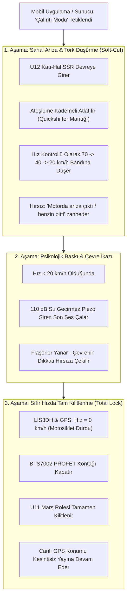

# AutoMoto — Hedef Kitle, Pazar Konumlandırması ve Kullanım Senaryoları

Bu doküman; AutoMoto akıllı motosiklet güvenlik, telemetri ve anahtarsız biniş (Keyless Go) platformunun **birincil hedef kitlesini**, seçilen pazar segmentinin **elektriksel/mekanik kısıtlarını** ve bu kısıtlara yönelik geliştirilen **ürün-pazar uyumu (Product-Market Fit)** çözümlerini tanımlar.

---

## 1. Pazar Konumlandırması ve Hedef Segment

Büyük hacimli lüks motosikletlerde (650cc+ BMW GS, Yamaha MT-09, Honda Africa Twin vb.) fabrikasyon olarak çipli anahtar (immobilizer), gelişmiş ECU şifrelemesi ve çoğunda orijinal Keyless sistemleri standart olarak sunulmaktadır. Bu segmentte sonradan takılan sistemlerin pazar ihtiyacı düşüktür.

AutoMoto'nun birincil hedef kitlesi; Türkiye ve gelişmekte olan ülkelerde pazarın **%80'inden fazlasını** oluşturan, güvenlik açığı en yüksek ve kullanıcı sayısı en yoğun olan **100 cc – 400 cc sınıfı motosiklet ve skuterlerdir**:

```
                        HEDEF SEGMENT: 100 - 400 cc
   ┌──────────────────────────────┬──────────────────────────────┐
   │  Hindistan Menşeili          │  Japon Alt Segment           │
   │  - TVS (Jupiter, Raider,     │  - Honda (Dio, Spacy, Activa,│
   │    Ntorq, RTR 200)           │    PCX 125 baz modeller)    │
   │  - Bajaj (Pulsar NS200/RS200,│  - Yamaha (RayZR vb.)        │
   │    Dominar 250/400, Boxer)   │                              │
   ├──────────────────────────────┼──────────────────────────────┤
   │  Çin & Yerli Montaj         │  Kullanım Alanı              │
   │  - CFMOTO (250NK, 250SR)     │  - Kurye / Paket Servis      │
   │  - RKS, Kuba, Mondial,       │  - Şehir İçi Ulaşım          │
   │    Arora, Voge (125-300cc)   │  - Filo / Restoran Dağıtım   │
   └──────────────────────────────┴──────────────────────────────┘
```

---

## 2. 100-400 cc Segmentinin Anatomisi ve Donanımımızın Çözümleri

| Segmentin Özelliği / Zafiyeti | Neden Tehlikeli? | AutoMoto Donanımsal Çözümü |
|---|---|---|
| **İmmobilizer (Çipli Anahtar) Yok** | Kontak 2 veya 4 telli basit mekanik anahtardır. Tornavida sokup kırmak veya düz kontak yapmak 10 saniyedir. | **BTS7002 PROFET Anahtarı:** Mekanik kontak arkadan elektronik olarak kilitlenir. Fiziksel kontak yuvası kırılsa dahi devre açılmaz. |
| **Akü Kapasitesi Çok Küçük (4 Ah – 6 Ah)** | Standart takip cihazları uykuda 15–20 mA çeker; motor 3 gün yatarsa akü tamamen biter. | **Hibrit Düşük Güç & LiFePO4:** Uykuda $<100\,\mu\text{A}$ akım çekişi; harici 12V aküye sıfır yük bindiren dahili LiFePO4 batarya. |
| **Mekanik Gaz Teli (Kablolu Kelebek)** | Elektronik gaz teli (Ride-by-Wire) yoktur; tork yazılımla kısıtlanamaz. | **`U12` Katı-Hal SSR (VO14642):** Yan ayak veya ateşleme bobini üzerinden mikrosaniyelik darbeleme ile "Quickshifter / Devir Kesici" mantığı. |
| **Yüksek Hırsızlık Oranı (Kamyonete Yükleme)** | Hafif oldukları için (90 – 160 kg) seyyar çekiciler veya minibüslerle saniyeler içinde kaldırılır. | **LIS3DH 3-Eksen MEMS:** Kontak kapalıyken dik konuma getirilme veya kaldırılma anında donanımsal kesmeyle siren ve canlı GPS alarmı. |
| **Akü Kutup Başı Kesme Sabotajı** | Hırsızlar alarm sussun diye ilk iş selenin altındaki akü kablosunu keser. | **LM66100 İdeal Diyot + CN3058:** Ana güç kesildiği anda kesintisiz dahili bataryaya geçer ve sunucuya *"Sabotaj Alarmı"* basar. |

---

## 3. Kullanıcı Profilleri ve Kullanım Senaryoları

### Senaryo 1: Kurye ve Paket Servis Çalışanı ("Hands-Free Keyless")
* **Yaşanan Problem:**  
  Bir kurye günde 80–120 kez sipariş teslim eder. Aceleyle binaya koşarken anahtarı kontaktan çıkarmayı unutur veya cebinden anahtar çıkarmak vakit kaybettirir. Motosiklet hırsızlıklarının büyük kısmı bu birkaç dakikalık teslimat anlarında yaşanır.
* **AutoMoto Çözümü:**
  1. Kurye siparişi teslim etmek için motordan **3 metre uzaklaştığı an** (BLE sinyali kesildiğinde), kontak otomatik kapanır, katı-hal röle kilitlenir ve darbe alarmı devreye girer.
  2. Kurye teslimatı yapıp motora **1 metre yaklaştığında** kontak otomatik açılır. Kurye cepten anahtar çıkarmadan tek dokunuşla marşa basıp yola devam eder.

---

### Senaryo 2: Restoran / Filo Yöneticisi ("Gelişmiş Dükkan Kontrolü")
* **Yaşanan Problem:**  
  Dükkan sahipleri kuryelerin aşırı hız yapmasından, motorla kaza yapmasından ve mesai saatleri dışında motosikletleri şahsi işlerinde kullanmasından şikayetçidir.
* **AutoMoto Çözümü:**
  1. **Süreli Dijital Anahtar:** Dükkan sahibi mobil uygulamadan kuryeye *"Hafta içi 09:00 – 18:00 arası geçerli anahtar"* tanımlar. Mesai bitince anahtar otomatik iptal olur; motor dükkan önünde kilitli kalır.
  2. **Filo Hız Limiti (Örn: 60 km/h):** Kurye motorla 60 km/h üzerine çıktığında:
     - Karttaki 110 dB siren kesik kesik "Bip-Bip" öterek kuryeyi uyarır.
     - Dükkan sahibinin ekranına anlık bildirim düşer: *"Kurye Ahmet 60 km/h limitini aştı! Hız: 74 km/h"*.
     - Motor gaz kesici (Soft-Cut) moduna girerek hızın daha fazla artmasını mekanik olarak sınırlar.
  3. **Paket Servis Alanı Sınırı (Geofence):** Motosiklet dükkanın belirlediği servis yarıçapının (örn. 8 km) dışına çıkarsa işletmeciye hırsızlık/ihlal uyarısı iletilir.

---

### Senaryo 3: Bireysel Şehir İçi Kullanıcısı (Bajaj Pulsar / TVS Raider / Dio)
* **Yaşanan Problem:**  
  Kullanıcı motorunu apartman önüne veya iş yeri sokağına park eder. Disk kilidi takmak zahmetlidir, anahtar kaybetme riski vardır ve arkadaşına emanet verirken motorun zorlanmasından korkar.
* **AutoMoto Çözümü:**
  1. **Arkadaşa Misafir Anahtarı (Vale Modu):** Arkadaşına 2 saatlik anahtar paylaşır; ancak motora 50 km/h hız limiti tanımlar.
  2. **Tam Sabotaj Koruması:** Gece hırsızlar motoru sehpaya kaldırıp sürüklemeye çalıştığında, telefonuna anında yüksek öncelikli sesli arama/bildirim düşer.

---

### Senaryo 4: Kurye Gaspı ve Hareket Halinde Hırsızlık (Anti-Carjacking / Anti-Hijacking)
* **Yaşanan Problem:**  
  Özellikle gece vardiyasında paket servis kuryelerinin önü kesilip bıçak veya silah tehdidiyle motosikletleri zorla gasp edilebilmektedir. Kurye direnirse can güvenliği tehlikeye girer; direnmezse ekmek teknesini kaybeder.
* **AutoMoto Çözümü:**
  1. Kurye canını tehlikeye atmaz, hırsızla tartışmaz ve motosikleti teslim eder.
  2. Hırsız 100–150 metre uzaklaştığında kurye cebindeki telefonundan tek tuşla **"Gasp Edildim / Çalıntı Modu"** butonuna basar.
  3. Sistem motoru küt diye durdurup hırsızın kaza yapmasına veya motosikletin sürüklenip hurda olmasına neden olmaz; **3 Aşamalı Akıllı Yumuşak Durdurma (Smart Soft-Kill)** algoritmasını başlatır.
  4. Hırsız 100 metre ileride motorun arıza yaptığını zannederek sağa yanaşır, siren çığlık atar ve motosiklet kilitlenir. Kurye hem canını kurtarır hem de motorunu 1 sokak öteden hasarsız geri alır.

---

## 4. Mekanik Telli Motorlarda Hız Sınırlama Uygulama Algoritması

100-400 cc motorlarda elektronik gaz kolu bulunmadığından, hız kısıtlaması karttaki **`U12` Katı-Hal Opto-MOSFET (VO14642)** ile şu mantıkla yürütülür:

```
[Hız Algılama: GPS (1 Hz) veya CAN-Bus]
                  │
                  ▼
         [Hız > Tanımlı Limit mi?]
         ├── HAYIR ──> [U12 SSR Pasif (Normal Sürüş)]
         │
         └── EVET  ──> [1. Aşama: 110 dB Siren Kesik Bip]
                       [2. Aşama: Mobil Bildirim (Hız İhlali)]
                       [3. Aşama: U12 SSR ile Ateşleme Atlatma (Soft-Cut)]
                                 │
                                 ▼
              [Saniyede 15 ms Darbeleme (Ateşleme Atlatma)]
              [Tork Düşer, Arka Teker Kilitlenmez, Hız Sabitlenir]
```

> [!IMPORTANT]
> **Sürüş Emniyet Kriteri:**  
> Hız sınırı aşıldığında ana kontak hattı (`BTS7002`) **kesinlikle kapatılmaz.** Far, gösterge ve elektronik sistemler kesintisiz çalışmaya devam eder; yalnızca ateşleme darbelenerek motorun ivmelenmesi yumuşakça sınırlandırılır.

---

## 5. Hırsızlık Anında 3 Aşamalı Akıllı Yumuşak Durdurma (Smart Soft-Kill)

Hırsız motosikleti çalmış kaçarken uzaktan kontağı veya yakıtı aniden kesmek (Hard Kill); hırsızın düşmesine, arkadan gelen araçların çarpmasına, motosikletin hurdaya dönmesine ve ağır hukuki sorumluluklara yol açar.

AutoMoto, uzaktan gelen çalıntı ihbarında **kademeli ve kontrollü bir müdahale protokolü** uygular:



### Aşama Detayları:
1. **1. Aşama (Sanal Arıza - Hız Düşürme):**  
   `U12` Katı-Hal SSR, yan ayak veya bobin hattını darbeleyerek motor torkunu düşürür. Hırsız aracın uzaktan kapatıldığını anlamaz; motorun arızalandığını zannederek sağ şeride yanaşır ve güvenli şekilde yavaşlar.
2. **2. Aşama (Akustik & Görsel Baskı):**  
   Hız 20 km/h altına indiği anda 110 dB piezo siren ve flaşörler son ses ötmeye başlar. Çevredeki tüm insanların dikkati hırsıza çekilir; hırsız için tek seçenek motoru bırakıp yaya kaçmaktır.
3. **3. Aşama (Sıfır Hızda Tam Kilitlenme):**  
   LIS3DH ivmeölçer ve GPS hızın sıfırlandığını ($V = 0\text{ km/h}$) teyit ettiği an `BTS7002` kontağı kapatır, marşı kilitler. Akü sökülse dahi dahili LiFePO4 batarya sayesinde canlı GPS koordinatları polise ve sahibine akmaya devam eder.
