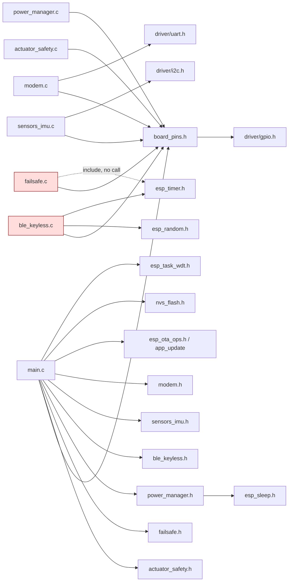

# 01 - Firmware Architecture Review (ESP32-S3 skeleton)

## Summary

- **The skeleton is a set of compiled-but-mostly-unwired modules.** Of the 8 `.c` modules, only init paths, the actuator consumer task, two LED/telemetry tasks and a few getters run at runtime. The soft-kill state machine, BLE verification, deep sleep, IMU wakeup configuration, command producers (`actuator_request_*`) and the modem AT path have **zero callers** (F-01-04, F-01-05). Nothing in the firmware can currently turn ignition on or crank the starter.
- **The "actuator_safety is the sole owner" claim is false as implemented.** `board_set_*` is a public API (`board_pins.h:53-57`) and at least three other modules write actuator pins directly: `failsafe.c`, `ble_keyless.c:52`, and `power_manager.c:46-48` (F-01-01). Ownership is by convention only; there is no lock, no static linkage, and no single writer enforcement.
- **Initialization is all-or-nothing.** Nine `ESP_ERROR_CHECK`s in `app_main` (`main.c:97-125`) abort on sensor/modem/BLE init failures that the rest of the device does not need. Any abort reboots into the same failure, leaving the bike with ignition open (fail-closed against theft, fail-open against the rider) (F-01-05).
- **Concurrency is minimal and unsynchronized.** Two tasks on Core 0 (prio 23 and 24 when soft-kill is active) and the BLE path can write the same GPIOs with no mutex. Only one queue exists (actuator commands), and it has no producers. There is no Core 0 ↔ Core 1 event bus; Core 1 reads actuator state through `volatile` globals and raw GPIO (`main.c:60-64`) (F-01-08, F-01-09).
- **The OTA rollback guard is defeated.** `verify_and_confirm_ota_rollback()` marks the image valid unconditionally and prints "Self-checks passed" with no self-test (`main.c:70-86`, `main.c:128`) (F-01-10).

## Scope & Method

**Files read in full** (worktree `T1-architecture`, HEAD `0c399ed`):
`firmware/main/{main,actuator_safety,board_pins,failsafe,power_manager,ble_keyless,sensors_imu,modem}.{c,h}`, `firmware/main/CMakeLists.txt`, `firmware/CMakeLists.txt`, `firmware/sdkconfig.defaults`, `firmware/platformio.ini`, `firmware/partitions.csv`, `firmware/README.md`, `firmware/SECURITY_SPECIFICATION.md`, `PROJECT.md`, `sim/README.md`, `sim/renode/automoto.resc`, `sim/renode/automoto.repl` (grep-level), `sim/wokwi/diagram.json` (grep-level), `hardware/pcb/PCB_SPECIFICATION.md` (grep-level for pins/pulls).

**Method:** every `#include` extracted with grep; every call to `board_*`, `gpio_*`, `actuator_*`, `failsafe_*`, `ble_keyless_*`, `power_manager_*`, `modem_*`, `sensors_imu_*`, `xTaskCreate*`, `ESP_ERROR_CHECK`, `esp_task_wdt_*` searched across `firmware/`, `sim/`, and root docs. Reachability is judged from `app_main` and the two created tasks, not from file presence.

**Line references:** `file:line` refers to the physical line in the worktree file. (Note: `cat -n` over multiple files in my own shell output was cumulative; all citations here were re-checked with per-file `grep -n`.)

**Could NOT verify (no ESP-IDF, no PlatformIO installed; nothing was built or flashed):**
- Default values of `configMAX_PRIORITIES` (assumed 25), main task core/priority/stack, `CONFIG_ESP_MAIN_TASK_STACK_SIZE`, and `CONFIG_ESP_SYSTEM_PANIC` behavior. [UNVERIFIED]
- ESP32-S3 GPIO power-on/reset default levels for `GPIO1-21, 38, 46-48` before `board_pins_init`, and whether a chip reset clears GPIO output latches. [UNVERIFIED]
- Whether `esp_sleep.h` is pulled in through `REQUIRES` transitively. [UNVERIFIED]
- Whether `gpio_get_level(PIN_IMU_INT1)` reads correctly when GPIO4 is never configured (`board_pins.c` does not configure it). [UNVERIFIED]
- Hardware pull-down/pull-up state of SSR/PROFET control nets at power-on (not traced in `PCB_SPECIFICATION.md` in this pass). [UNVERIFIED]
- Strapping-pin implications of GPIO3 / GPIO46 (ESP32-S3 datasheet). [UNVERIFIED]

---

## Findings

### 1. Module / dependency graph

Real `#include` edges and `REQUIRES`. "Effectively dead" = compiled and linked but unreachable from `app_main` or the two created tasks.

**Live vs dead, per exported function** (evidence: `grep` for callers outside the defining file):

| Module | Live at runtime | Effectively dead (compiled, zero callers) |
|---|---|---|
| `board_pins` | `board_pins_init` (`main.c:105`), `board_is_neutral` (`main.c:62`, `actuator_safety.c:55,100`), all `board_set_*` (only from owner, `failsafe.c`, `ble_keyless.c`) | none |
| `actuator_safety` | `actuator_safety_init` (`main.c:111`), task body, `actuator_is_cranking/ignition_on` (`main.c:63-64`) | `actuator_send_cmd`, `actuator_request_ignition/crank/emergency_shutdown` (`actuator_safety.h:36-39`) have **no callers**; the queue has **no producers** |
| `failsafe` | `failsafe_init` (`main.c:108`, no-op body `failsafe.c:50-52`) | `failsafe_trigger_soft_kill` (`failsafe.c:55`), `failsafe_cancel_soft_kill` (`failsafe.c:70`), `failsafe_get_kill_state` (`failsafe.c:82`), `failsafe_can_crank_starter` (`failsafe.c:87`) |
| `ble_keyless` | `ble_keyless_init` (`main.c:122`, only `memset`, `ble_keyless.c:40-47`), `ble_keyless_start_scan` (`main.c:37`, sets LED + nonce, `ble_keyless.c:20-28`) | `ble_keyless_verify_challenge_response` (`ble_keyless.c:31`) |
| `power_manager` | `power_manager_init` (`main.c:114`), `power_manager_get_wakeup_cause` (`main.c:115`) | `power_manager_enter_deep_sleep` (`power_manager.c:32`) |
| `sensors_imu` | `sensors_imu_init` (`main.c:119`, installs I2C driver), `sensors_imu_read_accel` (`main.c:28`) | `sensors_imu_configure_wakeup_threshold` (`sensors_imu.c:44`). The I2C driver is installed but **no I2C transaction exists** in the file |
| `modem` | `modem_init` (`main.c:125`), `modem_is_alive` (`main.c:51`), `modem_power_cycle` (`main.c:55`), `modem_get_gnss_fix` (`main.c:59`) | `modem_send_at` (`modem.c:63`) |

**REQUIRES audit** (`firmware/main/CMakeLists.txt:13-25`):

| REQUIRES entry | Used? | Evidence |
|---|---|---|
| `nvs_flash` | yes | `main.c:97` |
| `esp_timer` | yes | `ble_keyless.c:27` |
| `driver` | yes | `board_pins.c`, `modem.c:16-38`, `sensors_imu.c:15-27` |
| `freertos` | yes | multiple |
| `app_update` | yes | `main.c:5,72` |
| `esp_system` | yes | `esp_random.h` (`ble_keyless.c:34`), `esp_task_wdt.h` (`main.c:6`) |
| `log` | yes | multiple |
| `esp_partition` | yes (type only) | `main.c:72` |
| `bt` | **no** | no `esp_bt_*` / NimBLE header in `firmware/main` [VERIFIED by grep] |
| `esp_pm` | **no** | no `esp_pm_*` call; `CONFIG_PM_ENABLE=y` in `sdkconfig.defaults:42` |
| `mbedtls` | **no** | no `mbedtls` / `esp_crypto` call anywhere |
| `esp_event` | **no** | no `esp_event_*` call |

Also: `failsafe.c:6` includes `esp_timer.h` and never calls an esp_timer API [VERIFIED].

**Severity:** P2 (maintainability: dead dependencies inflate the image and mislead reviewers about what is wired).

---

### 2. Initialization order and failure analysis

Sequence in `app_main` (`main.c:88-134`):

| Step | Call (line) | Can fail? | If it aborts (`ESP_ERROR_CHECK`) | Actuator/pin state left behind |
|---|---|---|---|---|
| 1 | `nvs_flash_init` (`main.c:97-102`) | yes | `nvs_flash_erase()` on `NO_FREE_PAGES`/`NEW_VERSION` (`main.c:99`) **erases all NVS** before the check; other errors abort (`main.c:102`) | No GPIO configured yet. Pin state = hardware/reset default [UNVERIFIED] |
| 2 | `board_pins_init` (`main.c:105`) | yes (`gpio_config` returns) | abort | If the output `gpio_config` fails, the `gpio_set_level(...,0)` block (`board_pins.c:37-45`) is **never reached** (early return at `board_pins.c:33`). Outputs remain at reset default [UNVERIFIED] |
| 3 | `failsafe_init` (`main.c:108`) | never (`failsafe.c:50-52`) | n/a | n/a |
| 4 | `actuator_safety_init` (`main.c:111`) | queue + task creation (`actuator_safety.c:122-143`) | abort | Task is spawned here, **before** steps 5-9 run (ordering issue, F-01-06) |
| 5 | `power_manager_init` (`main.c:114`) | never (`power_manager.c:157-161`) | n/a | n/a |
| 6 | `sensors_imu_init` (`main.c:119`) | I2C param config + driver install (`sensors_imu.c:24-31`) | **abort** | ignition open, starter open, siren off, kill low, LEDs low. Reboot loop. Note: the IMU is never actually read over I2C (F-01-07) |
| 7 | `ble_keyless_init` (`main.c:122`) | never (`ble_keyless.c:40-47`) | n/a | n/a. It "succeeds" without any BLE stack (F-01-11) |
| 8 | `modem_init` (`main.c:125`) | `uart_param_config`, `uart_set_pin`, `uart_driver_install` (`modem.c:32-38`) | **abort** | as step 6. Also: `modem_init` performs a 3.2 s power cycle (`modem.c:42-44`) and **returns `ESP_OK` regardless of whether the modem came up** (`modem.c:45`) |
| 9 | `verify_and_confirm_ota_rollback` (`main.c:128`) | not an error path | n/a | marks image valid (F-01-10) |
| 10 | `xTaskCreatePinnedToCore` ×2 (`main.c:131-132`) | return value ignored | silent: no safety or cellular task, yet line 134 logs "initialized successfully" | outputs remain at last values; nobody updates LEDs/telemetry |

**Failure walk-through: "in what actuator state does the bike sit?"**

- **Abort at any step 1-8 (`ESP_ERROR_CHECK`)** → `abort()` → panic → reset (panic/reboot default [UNVERIFIED]; `CONFIG_ESP_TASK_WDT_PANIC=y` is set, `sdkconfig.defaults:23`). After reset, `app_main` runs again from step 1. If the fault is persistent (e.g. I2C device absent, which the code does not need), the device **bootloops**.
- **Bike state while looping:** PROFET ignition (`PIN_PROFET_IN`) is LOW once step 2 completes (`board_pins.c:38`) → ECU unpowered → **the bike cannot be started by any means**, including the mechanical key, because PROJECT.md states the PROFET *bypasses* the mechanical contact (`PROJECT.md:6`: "mekanik kontağı bypass eden katı-hal (`PROFET`)"). Starter SSR LOW (`board_pins.c:39`). Siren LOW (`board_pins.c:41`). Kill SSR LOW (`board_pins.c:37`), which means *kill not asserted*; with ignition open this is moot. Before step 2, all these pins are at hardware default (UNVERIFIED).
- **Consequence:** fail-closed against theft, **fail-open against the rider** (rider stranded). Combined with F-01-04 (no ignition path exists even when init succeeds), the skeleton as built cannot start the bike at all.

**Other init-order issues:**
- **NVS erase on any NVS error** (`main.c:98-99`): erases stored keys/bonds. `SECURITY_SPECIFICATION.md` §3.3 requires a 50-entry nonce store and §2.3 requires bonding; an NVS corruption would silently wipe bonds, and no recovery is logged beyond the generic log. P2.
- **Actuator task starts before the sensors it supervises** (`main.c:111` vs `119-125`). Harmless today (no producers), but the TWDT is armed (`actuator_safety.c:23`) before init completes.

**Severity:** P1 for the strand/bootloop finding (blocks release; F-01-05). P2 for NVS-erase and ordering.

---

### 3. FreeRTOS task table

| Task | Function (location) | Core | Priority | Stack | Period / blocking | TWDT | Created |
|---|---|---|---|---|---|---|---|
| `main` (app_main) | `app_main` `main.c:88` | [UNVERIFIED] default (CPU0) | [UNVERIFIED] default (1) | [UNVERIFIED] default | runs init, then returns (self-delete) | no | runtime |
| `actuator_safety` | `actuator_safety_task` `actuator_safety.c:18-115` | 0 (`actuator_safety.c:138`) | `configMAX_PRIORITIES - 2` = 23 if configMAX = 25 [UNVERIFIED] (`actuator_safety.c:136`) | 4096 (`actuator_safety.c:134`) | `xQueueReceive(..., 20 ms)` (`actuator_safety.c:36`), software countdown `-= 20` per iteration (`actuator_safety.c:112`) | **yes** (`actuator_safety.c:23`, feed at `:33`) | `main.c:111` |
| `soft_kill_task` | `soft_kill_worker_task` `failsafe.c:12-46` | 0 (`failsafe.c:65`) | `configMAX_PRIORITIES - 1` = 24 (`failsafe.c:63`) | 4096 (`failsafe.c:61`) | `vTaskDelay` 15 ms pulses ×100 (`failsafe.c:19-24`), 2 s siren (`:30`), then 500 ms siren blink loop (`:39-43`). **Fixed timeline, no speed input** | no | **never created** (only via `failsafe_trigger_soft_kill`, zero callers) |
| `safety_core0` | `safety_core0_task` `main.c:21-41` | 0 (`main.c:131`) | 5 (`main.c:131`) | 4096 (`main.c:131`) | `vTaskDelay(500 ms)` (`main.c:39`); IMU read + LED + BLE "scan" | no | `main.c:131` |
| `cellular_core1` | `cellular_core1_task` `main.c:44-68` | 1 (`main.c:132`) | 4 (`main.c:132`) | 4096 (`main.c:132`) | `vTaskDelay(3000 ms)` (`main.c:66`); **`modem_power_cycle` blocks 3.2 s** (`modem.c:51-55`) when modem not alive (`main.c:54-55`) | no | `main.c:132` |
| IDLE0 / IDLE1 | FreeRTOS | 0 / 1 | 0 | system | n/a | **yes** (`sdkconfig.defaults:21-22`) | system |
| Timer service, NimBLE host | none configured | n/a | n/a | n/a | **absent** (no BLE stack) | n/a | n/a |
| UART1 driver | ISR/driver, no event task (`modem.c:38`: `NULL, 0` queue) | n/a | n/a | n/a | blocking reads only in `modem_send_at` (`modem.c:72`), which has no callers | n/a | `modem.c:38` |

**Priority inversion analysis:**
- **No mutex, semaphore, or event group exists anywhere in `firmware/main`** [VERIFIED by grep]. Classic priority inversion therefore cannot occur, but neither is anything protected: the `board_set_*` functions are unsynchronized (F-01-09).
- **Preemption, not inversion, is the real risk:** the soft-kill task (prio 24) preempts the actuator task (prio 23) mid-sequence. Both write `PIN_PROFET_IN`, `PIN_PROFET_DEN`, `PIN_SSR_KILL`, `PIN_SIREN_CTRL` (`failsafe.c:20-22,29,35-36,40-42`; `actuator_safety.c:40-92`). Last-writer-wins is nondeterministic.
- **Crank countdown is preemption-sensitive:** the decrement is per loop iteration, not wall-clock (`actuator_safety.c:112`). A prio-24 preemption of 1+ s stretches the real crank duration past `MAX_CRANK_HARD_LIMIT_MS = 1500` (F-01-03).
- **Core 1 reads Core 0 state without any sync:** `actuator_is_cranking()` / `actuator_is_ignition_on()` (`main.c:63-64`). `volatile bool` reads are word-atomic, but the pair is not a consistent snapshot. P3.
- **Stack sizing:** all four tasks use 4096 B (`actuator_safety.c:134`, `failsafe.c:61`, `main.c:131-132`). No `uxTaskGetStackHighWaterMark` call exists [VERIFIED by grep]. Adequacy unknown [UNVERIFIED].

**Findings for this section:**
- Task list is correct for what is wired; the `soft_kill_task` row is a *latent* P0 (see F-01-04).

---

### 4. Actuator ownership verdict

**Documented claim.** The phrase "sole owner" does **not** appear verbatim in the repo [VERIFIED by grep for `sole|owner|tek sahip|exclusive`]. The closest statements are:
- `firmware/README.md:36` — "Marş rölesi (`U11`), kontak PROFET'i (`U10`) ve Soft-Cut SSR'si (`U12`) genel ağ veya telemetri görevlerinden tamamen izole edilmiştir." ("…completely isolated from general network or telemetry tasks.")
- `firmware/README.md:37` — "Core 0 üzerinde `configMAX_PRIORITIES - 2` seviyesinde koşturulur."
- `actuator_safety.h:35` — "Thread-Safe Non-Blocking Komut Gönderme … (Core 1 veya Kesmelerden çağrılabilir)" — i.e. the API is advertised as callable from Core 1 and ISRs, which contradicts isolation.

I treat the verdict against the README isolation claim, which is the strongest form.

**Verdict: FALSE as implemented.** The queue discipline is right in principle (one consumer, `actuator_safety.c:36`), but:
1. `board_set_ignition / board_set_starter / board_set_siren / board_set_kill_ssr` are **public** (`board_pins.h:53-56`) with no access control, and the same GPIOs are also written with raw `gpio_set_level` outside `board_pins.c`.
2. Writers outside `actuator_safety`:

| # | Location | Write | Via queue? |
|---|---|---|---|
| 1 | `failsafe.c:20`, `:22` | `board_set_kill_ssr` (15 ms pulse loop) | no |
| 2 | `failsafe.c:29`, `:40`, `:42` | `board_set_siren` | no |
| 3 | `failsafe.c:35` | `board_set_ignition(false)` | no |
| 4 | `failsafe.c:36` | `board_set_kill_ssr(true)` | no |
| 5 | `failsafe.c:76` | `board_set_siren(false)` (cancel path) | no |
| 6 | `failsafe.c:77` | `board_set_kill_ssr(false)` (cancel path) | no |
| 7 | `ble_keyless.c:52` | `board_set_ignition(true)` — **ignition ON, direct** | no |
| 8 | `power_manager.c:46` | `gpio_set_level(PIN_SSR_KILL, 0)` (bypasses `board_set_*`) | no |
| 9 | `power_manager.c:47` | `gpio_set_level(PIN_SSR_STARTER, 0)` | no |
| 10 | `power_manager.c:48` | `gpio_set_level(PIN_SIREN_CTRL, 0)` | no |
| 11 | `board_pins.c:37-41` | boot-time LOW on all actuator pins | n/a (boot only; acceptable) |

   Non-actuator GPIO writes (not offenders, listed for completeness): `main.c:31,33` (ALARM LED), `main.c:52,54` (GSM LED), `ble_keyless.c:23` (BLE LED), `board_pins.c:42-45` (LEDs/PWRKEY), `modem.c:51,53` (PWRKEY, via `modem_power_cycle` called from `main.c:55` and `modem.c:43`). PWRKEY is not an actuator per PROJECT §3.1, but the modem can be power-cycled from Core 1 with no interlock.

3. **The owner is idle.** `actuator_request_*` and `actuator_send_cmd` have zero callers (`actuator_safety.h:36-39`). So today the *only* actuator writes that can occur at runtime are: (a) the owner's own (unreachable), (b) boot-time LOW, and (c) `ble_keyless_verify_challenge_response` if called (not called). That means the "single owner" is currently a no-op, and the first developer to wire BLE or remote-start will almost certainly call `board_set_ignition` directly, as `ble_keyless.c:52` already does.

4. **Ignition state desync caused by offender #7.** `ble_keyless.c:52` sets the PROFET pin but never updates `s_ignition_active` (`actuator_safety.c:14`). `actuator_is_ignition_on()` then returns `false` while ignition is physically ON (`actuator_safety.c:192`), and the crank gate `if (!s_ignition_active)` (`actuator_safety.c:50`) rejects cranks in that state. The owner's flag is only updated by its own `ACT_CMD_IGNITION_SET` path (`actuator_safety.c:39`).

5. **Crank can be latched without a starter write.** `actuator_safety.c:64-66` sets `s_cranking_active = true` *before* `board_set_starter(true)`, and `board_set_starter` silently refuses when not neutral (`board_pins.c:75-78`, void return). The countdown then runs with the starter pin LOW.

**Severity:** P0 (theft-enabling / safety-of-life: ignition and starter have multiple unsynchronized writers, and the one that turns ignition ON bypasses the owner's bookkeeping).

---

### 5. Missing system state machine and inter-core event bus

#### 5.1 State machine: absent

No `state`, `armed`, `disarmed`, `riding`, `alarm` or `service` identifier exists in `firmware/main` [VERIFIED by grep]. The only state enums are:
- `soft_kill_state_t` (`failsafe.h:11-16`): IDLE / PULSING_TORQUE_CUT / ACOUSTIC_WARNING / FULL_LOCKOUT (not wired, see F-01-04).
- `automoto_wakeup_reason_t` (`power_manager.h:134-140`).
- Booleans `s_ignition_active`, `s_cranking_active` (`actuator_safety.c:14-15`).

PROJECT.md implies the following (citation = source of the implied transition):

| Transition | Trigger | Source |
|---|---|---|
| DISARMED → ARMED | rider leaves BLE proximity; "kontak kapanır ve alarm kurulur" | `PROJECT.md:19` |
| ARMED → ALARM | IMU motion / tamper INT | `PROJECT.md:13-16`, `:82`; wakeup `power_manager.c:20-22` |
| ARMED/DISARMED → IGNITION_ON | BLE challenge-response verified (+RSSI as hint only) | `PROJECT.md:19-20`; `SECURITY_SPECIFICATION.md:47-62` |
| IGNITION_ON → CRANKING → IGNITION_ON | `REMOTE_START` or manual, crank ≤ 1500 ms, neutral required | `PROJECT.md:23`, `:136-143`, `:158`; `actuator_safety.c:48-68` |
| ANY → RIDING | speed > threshold (IMU/GNSS) | `PROJECT.md:159` ("Araç hareket halindeyken uzaktan emniyet kapatma devreye alınmaz") |
| RIDING → SOFT_KILL (remote `KILL`) | must be **queued** until V=0, not executed | `PROJECT.md:159`, `SECURITY_SPECIFICATION.md:134` |
| SOFT_KILL stage 1 → 2 → 3 | stage 1 ends at speed < 20 km/h, stage 3 at V=0 | `SECURITY_SPECIFICATION.md:136-138`; code uses fixed timers only (`failsafe.c:19,30`) |
| FULL_LOCKOUT → DISARMED | authenticated command only; **undefined** in code (`failsafe.c:33-36`; no clear path) | — |
| ANY → EMERGENCY_OFF | `ACT_CMD_EMERGENCY_SHUTDOWN` (`actuator_safety.c:85-93`) leaves `KILL` latched; recovery requires explicit `KILL_SSR_SET(false)` | — |
| ACTIVE → DEEP_SLEEP → WAKE(reason) | parked; `PROJECT.md:77-82` | `power_manager.c:32-48` (dead) |
| BOOT → PENDING_VERIFY → VALID | OTA | `main.c:70-86` |
| MODEM_DOWN ↔ MODEM_UP | STATUS pin + PWRKEY pulse | `main.c:51-56` |
| ONLINE / OFFLINE (LWT) | MQTT | `PROJECT.md:102-104` (no MQTT code) |

Note: `SERVICE` (named in the review brief) does **not** appear in PROJECT.md [VERIFIED by grep]. Recommend not designing for it until the product spec defines it.

**Where it should live:** a new `vehicle_state.{c,h}` owned by a single supervisor task on Core 0 (prio between 5 and 23, e.g. 20), fed by an event queue (§5.2). It owns the authoritative `ARMED / DISARMED / IGNITION_ON / CRANKING / RIDING / SOFT_KILL / LOCKOUT / EMERGENCY` value, and exposes:
- `vehicle_state_get_snapshot(vehicle_snapshot_t *out)` (copy under critical section) for Core 1 telemetry.
- Gate functions consumed by `actuator_safety`: `allow_ignition(...)`, `allow_crank(...)`. `actuator_safety` remains the **only** GPIO writer; state machine decides, actuator executes.

**Severity:** P0 (the speed-gated remote kill and the armed/disarmed gate are safety-of-life requirements, currently absent).

#### 5.2 Inter-core event bus: absent

Current Core 0 ↔ Core 1 data flow, exhaustively:
- **Core 1 → Core 0:** none. No queue, no notification, no shared struct.
- **Core 0 → Core 1:** `actuator_is_cranking()` / `actuator_is_ignition_on()` (`main.c:63-64`) via `volatile` globals; `board_is_neutral()` read directly from GPIO by Core 1 (`main.c:62`). `gnss_fix` and modem status stay local to Core 1.
- **Shared mutable state with no locking:** `current_kill_state` (`failsafe.c:9`), `current_challenge` (`ble_keyless.c:9`, written from scan path and verify path), `s_ignition_active` / `s_cranking_active` (`actuator_safety.c:14-15`), `s_crank_remaining_ms` (`actuator_safety.c:16`, non-volatile, owner only).
- **Only queue:** `s_actuator_queue` (`actuator_safety.c:123`), single consumer, zero producers.
- `esp_event` is in `REQUIRES` (`CMakeLists.txt:20`) but not used. It may have been intended as the bus; no code exists.

**What a bus needs (interfaces implied by PROJECT.md §5.1 and §6):**
- *Commands in:* MQTT `automoto/{id}/commands` payload (`PROJECT.md:96-98`, `:133-145`) → Core 1 parses and validates HMAC/nonce (`SECURITY_SPECIFICATION.md:94-113`) → posts `cmd_t` to the state machine queue (not directly to actuators).
- *Events out:* alarm, ignition change, kill, lockout, power loss → Core 1 MQTT `events` topic (`PROJECT.md:93-95`).
- *Telemetry snapshot:* periodic read of `vehicle_snapshot_t` (`PROJECT.md:108-131`: `state`, `ignition`, `rssi_gsm`, GNSS).
- *Responses:* `response` topic with `cmd_id` (`PROJECT.md:147-155`) — requires the command result to flow back, i.e. a result queue or event-group bit per `cmd_id`.

Recommended minimal shape: one `QueueHandle_t` for inbound events (producers: BLE, IMU ISR-deferred, modem RX, timer, safety supervisor), one for outbound events (consumed by Core 1), and a `portMUX`-protected snapshot struct. ISRs must not call `board_set_*` (no ISR is registered today; `board_pins.c:53` disables GPIO interrupts).

**Severity:** P1 (blocks the cloud-command path; no bus = no remote start, no remote kill, no event publication).

---

### 6. Error-handling strategy

Four mechanisms are in use; none is consistent.

**6.1 `ESP_ERROR_CHECK` in `app_main`** — 9 call sites (`main.c:99,102,105,108,111,114,119,122,125`). Any failure reboots. Problems: (a) a non-critical sensor (IMU, whose data path never uses I2C, F-01-07) and the modem can brick the device into a reboot loop; (b) no degraded mode (e.g. "run alarm + BLE without modem"); (c) abort leaves outputs at reset default before step 2. **P1.**

**6.2 Ignored `esp_err_t` / `BaseType_t`:**
- `main.c:81` — `esp_ota_mark_app_valid_cancel_rollback()` return ignored.
- `main.c:131-132` — `xTaskCreatePinnedToCore` return ignored; line 134 then reports success (`main.c:134`). **If a task fails to spawn, the device "boots successfully" with no safety/telemetry loop.** P1.
- `failsafe.c:58-65` — soft-kill task creation return ignored. If it fails, the kill path silently does nothing. P1 (latent).
- `modem.c:67-69` — `uart_flush`, `uart_write_bytes` returns ignored.
- `modem.c:86-91, 53-55` — `modem_power_cycle` always returns `ESP_OK` (`modem.c:55`); `modem_init` ignores its outcome (`modem.c:42-45`).
- `main.c:28` — `sensors_imu_read_accel` return ignored (it cannot fail, F-01-07).

**6.3 `gpio_set_level` unchecked:** `gpio_set_level` returns `esp_err_t`; **25 call sites** in `firmware/main` [VERIFIED by grep], none checked. The ones on actuator pins are: `board_pins.c:37-41, 67-68, 77, 80, 85, 90`, `power_manager.c:46-48`. `board_set_*` return `void` (`board_pins.h:53-56`), so the owner cannot learn that an actuator write failed. A failed `gpio_set_level` on `PIN_PROFET_IN` leaves ignition state silently inconsistent with `s_ignition_active`. Also `gpio_get_level` (`board_pins.c:96`, `modem.c:60`, `sensors_imu.c:40`) cannot signal failure. **P1.**

**6.4 Log-only failures (no state change, no retry, no safe-state transition):**
- `actuator_safety.c:23-26` — TWDT registration failure logs a warning and **continues** with no watchdog. Given that TWDT is the only safety net (F-01-02), this should be fatal or at minimum trigger a safe state. P1.
- `board_pins.c:75-78` — starter refusal logs `CRITICAL` but returns `void`; the owner has already latched `s_cranking_active` (`actuator_safety.c:64-65`). P2.
- `actuator_safety.c:153` — queue full logs and returns `ESP_ERR_TIMEOUT`, but no caller exists. A dropped *crank-stop* or *emergency* would be silent. P2 (latent).
- `ble_keyless.c:72-73` — "SECURITY ALERT: Relay attack suspected!" logs and returns false; no alarm LED/event. Per `SECURITY_SPECIFICATION.md:62` it should "sessiz alarm günlüğü tutulur" (keep a silent alarm log), which is not implemented. P2.
- `main.c:30` — "Movement detected! Verifying vehicle authorization..." logs a verification that never happens. Misleading log. P3.
- `modem.c:86-90` — GNSS returns hard-coded İzmir coordinates with `gps_fixed=true` (F-01-10).

**6.5 Watchdog as the only "unknown-unknown" safety net:** TWDT covers the actuator task only (`actuator_safety.c:23`). It does **not** cover `safety_core0`, `cellular_core1`, or `soft_kill_task`. The README claim "Eğer sistem kilitlenirse … tüm röleleri 0 … seviyesine çeker" (`firmware/README.md:38`) holds only if the actuator task starves or the idle task starves (`sdkconfig.defaults:21-22`). If `safety_core0` hangs, outputs stay frozen at their last value (e.g. IGNITION_ON). **P1.**

**Is the strategy adequate for a device that can strand a rider?** No. The logging is reasonable for a dev board, but there is no fault state, no retry policy, no degraded mode, and no persistence of faults (no NVS fault log, no `esp_reset_reason()` read, `grep` returned none [VERIFIED]). Boot-time failures cannot be diagnosed remotely because the modem is initialized *after* the IMU and BLE (`main.c:119-125`).

---

### 7. Findings (formal list)

Severity legend: P0 = safety-of-life or theft-enabling; P1 = blocks release; P2 = reliability/maintainability/debuggability; P3 = polish/docs drift.

### F-01-01 - Actuator ownership is by convention; 3 modules write actuator GPIO directly [P0] [VERIFIED]

- **Evidence:** `board_set_*` public (`firmware/main/board_pins.h:53-56`). Direct writers: `failsafe.c:20-22,29,35-36,40-42,76-77`; `ble_keyless.c:52`; `power_manager.c:46-48`. Full table in §4.
- **Failure mode + trigger:** Any call to `board_set_ignition(true)` from BLE verify (`ble_keyless.c:52`) turns ignition ON without updating `s_ignition_active` (`actuator_safety.c:14`). Soft-kill (`failsafe.c:35-36`) writes PROFET/kill from prio 24 while the owner (prio 23) may write the same pins.
- **Consequence:** ignition state desync (`actuator_is_ignition_on()` lies, `actuator_safety.c:192`); nondeterministic last-writer-wins on kill/ignition during soft-kill; crank gate uses stale state (`actuator_safety.c:50`).
- **Fix sketch:** make `board_set_*` `static` to `board_pins.c` (or move to `actuator_hal.h` with a `static` or `#ifdef ACTUATOR_OWNER` guard). Route all of `failsafe.c`, `ble_keyless.c`, `power_manager.c` through `actuator_send_cmd()`. Make `power_manager_enter_deep_sleep` request `ACT_CMD_*` and wait for ack before `esp_deep_sleep_start`.
- **Verification:** `grep -rn "board_set_\|PIN_PROFET_IN\|PIN_SSR_\|PIN_SIREN_CTRL" firmware/main` must show writes only in `board_pins.c` and `actuator_safety.c`. Build-level check requires ESP-IDF (NOT RUN).

### F-01-02 - TWDT covers one task; its failure path is log-only and its claimed coverage is overstated [P1] [VERIFIED]

- **Evidence:** `actuator_safety.c:23-26` (registration, log-only on failure); no `esp_task_wdt_add` in `main.c` (`main.c:21-68`) or `failsafe.c`. `firmware/README.md:38` claims system-wide lockup → relays to 0.
- **Failure mode + trigger:** `safety_core0` hangs (e.g. blocked in BLE scan or future I2C) → TWDT not fed for that task → no panic → outputs frozen as last written. Or TWDT registration fails → continues with no watchdog.
- **Consequence:** the documented "lockup → relays off" guarantee does not hold for most lockups. The bike can remain in IGNITION_ON through a hung supervisor.
- **Fix sketch:** register every long-lived task; make registration failure fatal (or set a safe state and refuse to run). Add a fault-aware heartbeat: the owner forces `KILL`/`IGNITION=OFF` if the supervisor's heartbeat is stale for N ms.
- **Verification:** target test (Renode/Wokwi cannot model TWDT faithfully per `sim/README.md`) [UNVERIFIED]; code review of `esp_task_wdt_add` return handling.

### F-01-03 - Crank hard limit is a software iteration counter, not wall-clock [P1] [VERIFIED] / [INFERRED]

- **Evidence:** `actuator_safety.c:112` decrements `s_crank_remaining_ms -= 20` once per loop iteration; the loop is also woken early by `xQueueReceive` (`actuator_safety.c:36`). `firmware/README.md:39` claims an "independent timer" enforces 1500 ms "en geç".
- **Failure mode + trigger:** a command arrives → loop runs early → counter drops by 20 ms of *loop time* that was actually shorter; or a prio-24 soft-kill preemption (`failsafe.c:63`) stalls the owner for > 1 s → real crank duration exceeds 1500 ms. [INFERRED: rate of commands/preemption under load.]
- **Consequence:** starter SSR stays closed past the stated hard limit (starter/battery damage, the very case `README.md:39` says the limit prevents). Not directly life-threatening but violates a documented safety claim.
- **Fix sketch:** use `esp_timer_get_time()` deadline (`ble_keyless.c:27` already uses `esp_timer`), i.e. `crank_deadline_us = now + duration` and check `now >= deadline` each loop; or a `esp_timer` one-shot that posts `CRANK_STOP`. Hardware-level: a discrete RC/monostable on the starter SSR enable is the only true independent limit.
- **Verification:** unit test on host with fake clock [UNVERIFIED — no harness exists].

### F-01-04 - Safety-critical control paths are compiled but unreachable (latent P0 gap) [P0] [VERIFIED]

- **Evidence:** zero callers outside their modules for: `failsafe_trigger_soft_kill` (`failsafe.c:55`), `failsafe_cancel_soft_kill` (`failsafe.c:70`), `failsafe_can_crank_starter` (`failsafe.c:87`), `actuator_request_*` (`actuator_safety.h:36-39`), `ble_keyless_verify_challenge_response` (`ble_keyless.c:31`), `power_manager_enter_deep_sleep` (`power_manager.c:32`). Only `failsafe_init` (`main.c:108`) runs.
- **Failure mode + trigger:** none runs today, so the *current* firmware cannot kill the engine or start it. When these are wired in later, the PROJECT §6 rules (remote kill queued until V=0, speed-gated) are not implemented: `failsafe.c:17-42` is purely timed; there is no speed input anywhere (`grep` for `speed`/`velocity` finds only `modem.c:88` mock).
- **Consequence:** wiring `failsafe_trigger_soft_kill` today would execute a 3-second torque cut at any speed, including highway speed, violating `PROJECT.md:159`. Latent but safety-of-life.
- **Fix sketch:** do not expose soft-kill to any command path until the state machine (§5.1) gates it on `speed_kmh < 20` (stage 1 exit) and `speed_kmh == 0` (stage 3). Add a `RIDING` state with explicit "queue until stopped" for remote KILL.
- **Verification:** code review; ensure `failsafe_trigger_soft_kill` has no caller until the gate exists.

### F-01-05 - Initialization aborts strand the rider; ESP_ERROR_CHECK on non-critical peripherals causes reboot loops [P1] [VERIFIED] / [INFERRED]

- **Evidence:** `main.c:119` (IMU, which is never read over I2C: `sensors_imu.c:34-41`), `main.c:125` (modem), `main.c:122` (BLE, which initializes nothing: `ble_keyless.c:40-47`), `main.c:99,102` (NVS erase), and PROJECT.md:6 (PROFET bypasses the mechanical contact).
- **Failure mode + trigger:** a missing/defective LIS3DH (I2C driver install fails, or no device: though no transaction is made, `i2c_driver_install` can still fail on bus config) or a modem UART issue → abort → reboot loop. Ignition open throughout (`board_pins.c:38`).
- **Consequence:** the bike cannot be started by any route, including the mechanical key (bypassed by design). **Rider stranded.** Also: the device is non-functional for anti-theft while looping, with no event published.
- **Fix sketch:** separate critical (actuator, safety task, TWDT) from non-critical (IMU, modem, BLE) init. Non-critical failures set a `DEGRADED` flag and continue. Provide a documented manual override (e.g., a service-mode jumper or a mechanical bypass) — none is specified in the repo [VERIFIED: grep for `override|manuel|manual|yedek` found no relevant hits]. Stop erasing NVS on generic errors (`main.c:98-99`); erase only on specific corruption codes and log a counter.
- **Verification:** boot tests with each peripheral disconnected [UNVERIFIED — no HIL].

### F-01-06 - Actuator task spawned before supervised subsystems are initialized [P2] [VERIFIED]

- **Evidence:** `main.c:111` (actuator init, TWDT armed in `actuator_safety.c:23`) precedes `main.c:119-125`.
- **Failure mode + trigger:** any future producer that enqueues during steps 5-8 would be consumed before the power/IMU/modem layers are ready.
- **Consequence:** ordering hazard; not exploitable today because the queue has no producers.
- **Fix sketch:** create the actuator task last, after all `*_init` succeed, or gate the queue with an "armed" flag that is set only at the end of `app_main`.
- **Verification:** code review.

### F-01-07 - IMU "read" is a fabricated success; LIS3DH is never configured [P1] [VERIFIED]

- **Evidence:** `sensors_imu.c:34-41` sets `x=0, y=0, z=1000` (comment: "1G yerçekimi varsayımı") and reads motion from `gpio_get_level(PIN_IMU_INT1)`, returning `ESP_OK`. `sensors_imu_configure_wakeup_threshold` only logs (`sensors_imu.c:44-47`). No I2C read/write exists. `board_pins.c:49-53` does not configure `PIN_IMU_INT1` (GPIO4) as input.
- **Failure mode + trigger:** LIS3DH unpowered, miswired, or misconfigured → `sensors_imu_read_accel` still returns `ESP_OK`; motion is whatever GPIO4 reads (possibly floating [UNVERIFIED]).
- **Consequence:** the theft/tamper detector can neither detect a fault nor report one; the ALARM LED follows an unconfigured pin (`main.c:28-34`). Also, the IMU is a `REQUIRES`-level dependency that aborts boot (F-01-05).
- **Fix sketch:** implement LIS3DH register configuration (CTRL_REG*, INT1_CFG/THS, WHO_AM_I check) with error returns; configure GPIO4 as input with explicit pull; read the 3-axis data for speed/tilt estimation (needed for F-01-04).
- **Verification:** WHO_AM_I check on hardware [UNVERIFIED]; code review.

### F-01-08 - No inter-core event bus; no shared-state discipline [P1] [VERIFIED]

- **Evidence:** §5.2. Only Core 0→1 data channel is `volatile` globals and raw GPIO reads (`main.c:60-64`). No `QueueHandle_t` except the actuator queue (`actuator_safety.c:11,123`), no `EventGroupHandle_t`, no `portMUX`, no `esp_event` loop, despite `esp_event` in `REQUIRES`.
- **Failure mode + trigger:** cloud command (Core 1) and BLE verify (Core 0) cannot be serialized through a single state owner; the telemetry snapshot (`main.c:60-64`) is not atomic (ignition read and cranking read are separate loads).
- **Consequence:** cannot implement PROJECT §5.1 command/response flow or §6 "queue until V=0" without a bus.
- **Fix sketch:** see §5.2 (inbound/outbound queues + snapshot with `portMUX` or double-buffer).
- **Verification:** design review; no runtime test possible today.

### F-01-09 - Unsynchronized shared state across tasks and cores [P1] [VERIFIED]

- **Evidence:** `failsafe.c:9` (`current_kill_state`, written from soft-kill task at `:17,27,33,51,78`, read from any caller at `:82`); `ble_keyless.c:9,26-28,45,50` (challenge written from scan path and verify path; no lock); `actuator_safety.c:14-16` (`volatile` flags, `s_crank_remaining_ms` non-volatile).
- **Failure mode + trigger:** `ble_keyless_start_scan` (called every 500 ms from `main.c:37`) regenerates the nonce while `ble_keyless_verify_challenge_response` may be reading it. Soft-kill starts while the owner is in a crank countdown.
- **Consequence:** torn reads of the challenge struct (16-byte nonce + timestamp + flag); crank/kill interleavings not defined.
- **Fix sketch:** single-owner for each datum (the state machine, §5.1), or a critical section (`taskENTER_CRITICAL` with `portMUX`) for multi-field reads.
- **Verification:** code review.

### F-01-10 - OTA rollback is cancelled without a self-test; telemetry and IMU data can be fabricated [P1] [VERIFIED]

- **Evidence:** `main.c:70-86` calls `esp_ota_mark_app_valid_cancel_rollback()` (`:81`) immediately when the partition is `PENDING_VERIFY`, after printing "New firmware booted successfully! Self-checks passed." No check of actuators, IMU, modem, or BLE is performed before it. `firmware/README.md:47-48` says the mark must occur *after* all hardware tests pass. GNSS mock: `modem.c:86-90` returns İzmir coordinates with `gps_fixed = true` (comment: "Varsayılan mock koordinatları"). `main.c:60-64` publishes these as the real telemetry tick.
- **Failure mode + trigger:** a new OTA image that boots, runs but misses a peripheral (or has a broken IMU/actuator path) is marked valid, so the rollback safety net does not catch it. Any build with `modem_get_gnss_fix` unchanged reports a fixed location to the cloud.
- **Consequence:** rollback protection is nominal; location telemetry and geofence alerts are false.
- **Fix sketch:** move `mark_valid` into a `self_test()` that verifies: TWDT registered, actuator task responds to a no-op command, modem `AT` returns OK (once `modem_send_at` is wired), IMU WHO_AM_I matches, then `mark_valid`. Replace GNSS mock with real NMEA/CGNSINF parsing, or return `ESP_ERR_NOT_SUPPORTED` and `gps_fixed=false`.
- **Verification:** an OTA test with an intentionally broken image [UNVERIFIED — no HIL].

### F-01-11 - BLE "initialized" while no BLE stack is initialized; BLE config present but unused [P1] [VERIFIED]

- **Evidence:** `ble_keyless.c:13` logs "Initializing Apache NimBLE Keyless Go subsystem (v5.x standard)..." but `ble_keyless_init` only `memset`s (`ble_keyless.c:40-47`). No `nimble_port_init`, `esp_nimble_hci_init`, `esp_bt_controller_init`, or GATT registration exists [VERIFIED by grep]. `sdkconfig.defaults:31-38` enables NimBLE, SC, bonds; `CMakeLists.txt:14-15` lists `bt`, which is unused. `esp_fill_random` for nonces (`ble_keyless.c:26`) is real. Scan is an LED toggle (`ble_keyless.c:23`).
- **Failure mode + trigger:** every boot logs "NimBLE initialized" and proceeds. No device is discoverable and no GATT service exists; `ble_keyless_start_scan` only regenerates a nonce that nothing transmits.
- **Consequence:** the keyless-go function (PROJECT §2.2) does not exist; the BLE LED (`PIN_LED_BLE`) implies activity that does not occur. Misleading readiness.
- **Fix sketch:** either implement the NimBLE host/controller init and GATT service, or log "BLE NOT IMPLEMENTED" and mark `DEGRADED`. Remove `bt`/`esp_pm`/`mbedtls`/`esp_event` from `REQUIRES` until used (F-01-12).
- **Verification:** code review; build [NOT RUN].

### F-01-12 - Dead `REQUIRES` and unused includes [P2] [VERIFIED]

- **Evidence:** `firmware/main/CMakeLists.txt:13-25` lists `bt`, `esp_pm`, `mbedtls`, `esp_event` with no use (§1 table). `failsafe.c:6` includes `esp_timer.h` unused. `sdkconfig.defaults:42` enables `CONFIG_PM_ENABLE` with no `esp_pm` use.
- **Failure mode + trigger:** none at runtime; increases image size and misleads reviewers about the architecture.
- **Consequence:** false sense of coverage (e.g., "mbedtls hardware AES is enabled" while no crypto runs: `sdkconfig.defaults:46-49`).
- **Fix sketch:** prune `REQUIRES` to what is used; keep the sdkconfig block for features that exist.
- **Verification:** code review.

### F-01-13 - Wake-up and sleep architecture contradicts PROJECT.md; deep sleep unreachable; BLE cadence differs [P1] [VERIFIED]

- **Evidence:** PROJECT.md:80 — RTC wake every 1.5 s, 40-50 ms BLE scan. Code: `safety_core0` scans every 500 ms (`main.c:37,39`), never sleeps. `power_manager_enter_deep_sleep` never called (`power_manager.c:32`). EXT0 is assigned to the IMU (`power_manager.c:43`; `PROJECT.md:82` says IMU → EXT1) and the RI pin → EXT0 (`PROJECT.md:81`); **no RI pin is defined** in `board_pins.h`; `power_manager.c:173-174` describes EXT1 as the modem RI, which is not configured anywhere.
- **Failure mode + trigger:** the device runs always-on (order of mA on a bike battery), and any future sleep path wires the wrong pin to the wrong wake source.
- **Consequence:** battery drain (PROJECT.md:77 targets < 100 µA); RI-driven remote wake not possible as written.
- **Fix sketch:** add `PIN_MODEM_RI` to `board_pins.h`; implement the duty-cycled scan per PROJECT.md:80; align EXT0/EXT1 with PROJECT §4 or update the spec (decide and document). Note: ESP32-S3 ext0/ext1 wake requires RTC-capable pins [UNVERIFIED for GPIO4/GPIO21].
- **Verification:** power measurement [UNVERIFIED — no hardware].

### F-01-14 - Neutral-switch interlock is a single sensed pin that fails open on short-to-ground [P1] [INFERRED]

- **Evidence:** `board_is_neutral()` returns `gpio_get_level(PIN_SENSE_NEUTRAL) == 0` (`board_pins.c:96`) with pull-up enabled (`board_pins.c:51`; `PCB_SPECIFICATION.md:116` R4 10 kΩ). The LTV-356T pulls the line to GND when neutral (`board_pins.c:95` comment). All three crank gates depend on this one read (`actuator_safety.c:55,100`; `board_pins.c:75`; `failsafe.c:92`).
- **Failure mode + trigger:** a short from the sense line to GND (harness damage, wrong wiring, optocoupler failure C-E short) reads as neutral and permits the starter while the bike is in gear. An open circuit is correctly read as IN GEAR (fail-closed), but the short direction is not guarded.
- **Consequence:** starter energized in gear → bike moves while rider is not in control (PROJECT.md:158 explicitly forbids). Three software checks share one hardware fault domain.
- **Fix sketch:** add a second, independent neutral signal (e.g. a clutch-lever or kickstand sensor) or a plausibility check against IMU/GNSS speed (crank-in-motion rejected); add a self-test that the optocoupler reads "IN GEAR" with the switch open before any crank is allowed. Escalate to P0 if the PCB cannot detect the short.
- **Verification:** harness fault injection [UNVERIFIED — no hardware]; PCB review of `U9` fault modes.

### F-01-15 - Modem power-cycle logic can flap the modem on a misread STATUS pin [P2] [INFERRED]

- **Evidence:** `main.c:51-56` calls `modem_power_cycle()` (PWRKEY pulse 1.2 s + 2.0 s wait, `modem.c:51-54`) every 3 s whenever `modem_is_alive()` is false (`modem.c:60`, `gpio_get_level(PIN_MODEM_STATUS) == 1`). `modem_init` also toggles PWRKEY once if STATUS is low (`modem.c:42-44`), and ignores whether it succeeded (`modem.c:45`).
- **Failure mode + trigger:** STATUS polarity wrong, STATUS stuck, or the modem is on but STATUS reads 0 → PWRKEY toggles the modem **off** on every cycle.
- **Consequence:** modem oscillates; no cellular telemetry; power cycling on a live modem can corrupt SIM state. [INFERRED: depends on SIM808 STATUS semantics; not verified against datasheet.]
- **Fix sketch:** require N consecutive STATUS-low reads with backoff before toggling; verify with an AT ping (`modem_send_at`, currently unused) before power-cycling; log/alarm after K failed cycles.
- **Verification:** modem datasheet check [UNVERIFIED]; bench test [UNVERIFIED].

### F-01-16 - Error handling: ignored returns, void HAL, silent task-creation failure [P2] [VERIFIED]

- **Evidence:** §6.2-6.4. Key items: `main.c:131-132` (task create return ignored, then "success" at `main.c:134`); `failsafe.c:58` (same); `board_pins.h:53-56` (void actuator setters); `board_pins.c:75-78` (silent refusal path); 25 unchecked `gpio_set_level` sites; `actuator_safety.c:24-26` (TWDT-add log-only).
- **Failure mode + trigger:** any resource-allocation failure (heap at boot, task stack) or GPIO error is invisible to the caller and to the cloud.
- **Consequence:** the device can report "initialized successfully in secure state" (`main.c:134`) with no actuator-safety loop or no soft-kill capability.
- **Fix sketch:** make all actuator setters return `esp_err_t`; check `xTaskCreatePinnedToCore` results; define a `fault_report(code)` path that sets a state, sends an event (§5.2), and persists a counter in NVS.
- **Verification:** code review; fault injection [UNVERIFIED].

### F-01-17 - Concurrency: no lock between owner and out-of-owner writers; soft-kill preemption ordering [P2] [VERIFIED]

- Merged into F-01-01 and F-01-09 for the primary consequence; kept separate here for the concurrency table in §3 (preemption of prio-23 owner by prio-24 soft-kill, `failsafe.c:63` vs `actuator_safety.c:136`). **Fix:** single writer task (F-01-01), or a mutex around `board_set_*` (priority-inheritance mutex `xSemaphoreCreateMutex`, which avoids the inversion the owner could otherwise suffer).

### F-01-18 - Documentation and naming drift [P3] [VERIFIED]

- `PROJECT.md:59` says ESP32-S3-WROOM-1; `firmware/platformio.ini:61` says "WROOM-1U-N16R8"; `PROJECT.md:61`/`:65` name SIM7080G as the alternative while code/PCB use SIM808 (`main.c:125`, `modem.h:13-14` EG915U).
- `firmware/SECURITY_SPECIFICATION.md:47-62` claims AES-GCM challenge tokens and ±5 s replay windows; code has neither (`ble_keyless.c:31-53`).
- `sdkconfig.defaults:15` sets `CONFIG_SECURE_BOOT_SUPPORTS_PLAINTEXT_BOOTLOADER=y` (a "supports" flag) and no `CONFIG_SECURE_BOOT=y`/`CONFIG_SECURE_FLASH_ENC_ENABLED`; README §2.2 (`firmware/README.md:41-43`) presents Secure Boot v2 and Flash Encryption as active.
- The brief's "sole owner" phrasing is not in the repo (§4).
- **Fix:** update docs to match; disambiguate "planned" vs "enabled".

---

## 8. What the skeleton already gets right

Fair assessment: these are real strengths and should be preserved.

- **Safe GPIO defaults at init.** Every output actuator is driven LOW before anything else (`board_pins.c:37-41`), with the comment rationale "Varsayılan Güvenli Durum" (`board_pins.c:11`) — correct direction for PROFET ignition and starter.
- **Neutral is active-low with pull-up** (`board_pins.c:51,96`): an open sense wire is read as IN GEAR, i.e. crank denied. This is the right fail direction for the common fault.
- **Triple-checked neutral interlock in code:** starter-set path (`board_pins.c:75`), owner crank-start (`actuator_safety.c:55`), owner crank-running (`actuator_safety.c:100`), and `failsafe_can_crank_starter` (`failsafe.c:92`). Good defense-in-depth intent, even though the sensor is a single point (F-01-14).
- **Single-consumer command queue** (`actuator_safety.c:36`) is the correct pattern for an actuator owner. The API comment about thread-safe non-blocking submission (`actuator_safety.h:35`) states the right goal.
- **Crank hard-limit clamp** (`actuator_safety.c:60-63`) and **stop-on-neutral-loss during crank** (`actuator_safety.c:100-104`) implement the right safety rules; only the timer basis is weak (F-01-03).
- **Ignition-off also cuts the starter** (`actuator_safety.c:41-45`) — correct coupling of dependent actuators.
- **Emergency shutdown sequence is conservative** (`actuator_safety.c:85-93`): starter off, ignition off, kill asserted, all in one owner pass.
- **TWDT is enabled in config with panic** (`sdkconfig.defaults:18-23`), and the actuator task is subscribed (`actuator_safety.c:23`). Good intent, narrow coverage (F-01-02).
- **Staged soft-kill as an enum** (`failsafe.h:11-16`) matches the PROJECT §2.3 three-stage design; the time-based torque-cut pulse train (`failsafe.c:19-24`) is a plausible first implementation.
- **Partition table and OTA rollback are planned properly:** dual `ota_0`/`ota_1`, encrypted `nvs_keys` and `storage` (`partitions.csv:102-108`), `CONFIG_BOOTLOADER_APP_ROLLBACK_ENABLE=y` (`sdkconfig.defaults:13`), and a rollback-cancel hook (`main.c:70-86`). The mechanism is right even though the gate is weak (F-01-10).
- **Bluedroid disabled, NimBLE selected** (`sdkconfig.defaults:31-34`), matching the security spec's stack choice.
- **Clean HAL boundaries** with `extern "C"` guards and `esp_err_t` return types on most APIs; `board_pins.h` centralizes pin assignment, which makes a future PCB revision a one-file change.
- **Honest mock-labeling in places** (`modem.c:86` comment "Varsayılan mock koordinatları"; `sensors_imu.c:39` "1G varsayımı"). The issue is that these are not gated off in release builds (F-01-10).

---

## Open Questions

1. **Power-on GPIO state before `board_pins_init`:** are PROFET_IN (GPIO8), SSR_STARTER (GPIO9), SSR_KILL (GPIO3) pulled down in hardware? If not, a reset window exists in which ignition/starter could float HIGH. Needs a `PCB_SPECIFICATION.md` pull-down audit and an ESP32-S3 datasheet check. [UNVERIFIED]
2. **Polarity of SSR_KILL (GPIO3):** comment says Active HIGH = kill (`board_pins.h:22`); spec §5 says relays are normally open. Confirm whether "LOW = engine can run (given ignition)" is the intended safe default. [UNVERIFIED]
3. **Does `gpio_get_level(GPIO4)` on an unconfigured pin return a valid level in ESP-IDF v5.x?** Affects F-01-07. [UNVERIFIED]
4. **Should non-critical peripherals (IMU, modem, BLE) be allowed to fail boot?** Product decision; drives F-01-05.
5. **Manual/mechanical override for a failed electronic immobilizer:** is one required by the product spec? (PROJECT.md:6 implies the mechanical contact is bypassed.) This determines whether F-01-05 is P0 or P1. [UNVERIFIED]
6. **Is `SERVICE` a real state?** It is not in PROJECT.md; confirm with the product owner before designing for it.
7. **Does `esp_task_wdt` on ESP-IDF v5.x reboot or only panic under `CONFIG_ESP_TASK_WDT_PANIC=y`?** The README's "relays to 0" claim depends on the reset path. [UNVERIFIED]
8. **Is the 4096 B stack adequate** for `ESP_LOG` with `%lld`/`%f` formatting in `main.c:60-64` and `ble_keyless.c:69-73`? Measure with `uxTaskGetStackHighWaterMark` on hardware. [UNVERIFIED]

## Suggested Jobs

Ordered by safety impact. Each is scoped to a worker task.

1. **[P0] Enforce single actuator writer (F-01-01, F-01-17).** Make `board_set_*` private to `actuator_safety`; route `failsafe.c`, `ble_keyless.c:52`, `power_manager.c:46-48` through `actuator_send_cmd`. Add a grep-based CI check listing allowed writers.
2. **[P0] Introduce `vehicle_state` supervisor and gate table (F-01-04, §5.1).** Implement ARMED/DISARMED/IGNITION_ON/CRANKING/RIDING/SOFT_KILL/LOCKOUT/EMERGENCY with transition guards. Speed gate for soft-kill stage 1/3 (`SECURITY_SPECIFICATION.md:136-138`).
3. **[P0] Fix BLE ignition gate before wiring it (F-01-02 cross-ref, §4 item 7).** `ble_keyless_verify_challenge_response` must compare the response against the outstanding nonce, check RTT against the *transmit* timestamp, and emit `ACT_CMD_IGNITION_SET`. Security worker should own the crypto part.
4. **[P1] Replace iteration-based crank timer with `esp_timer` deadline (F-01-03).**
5. **[P1] Init restructure: critical vs degraded (F-01-05, F-01-06).** Actuator/safety critical; IMU/BLE/modem degradable; create actuator task last; stop NVS erase on generic errors.
6. **[P1] Real self-test before `mark_app_valid` (F-01-10).** Including removal of GNSS mock from release path.
7. **[P1] LIS3DH driver with WHO_AM_I and interrupt config (F-01-07).**
8. **[P1] Event bus: inbound/outbound queues + snapshot (F-01-08, §5.2).** Prerequisite for MQTT command path.
9. **[P1] Second neutral source or speed-plausibility check (F-01-14).** Needs PCB review.
10. **[P1] Watchdog coverage: register all long-lived tasks, make TWDT registration failure fatal (F-01-02).**
11. **[P1] Actually initialize NimBLE or report `DEGRADED` (F-01-11).**
12. **[P1] Wake-up/sleep alignment with PROJECT §4 and RI pin definition (F-01-13).**
13. **[P2] Prune REQUIRES, update docs to planned vs enabled (F-01-12, F-01-18).**
14. **[P2] Modem recovery policy with backoff and AT verification (F-01-15).**
15. **[P2] Fault reporting path: typed returns, task-create checks, NVS fault counter (F-01-16).**
16. **[P3] Consistent naming of SIM808 vs SIM7080G vs EG915U and WROOM variant across docs (F-01-18).**

**Not done here (out of scope for T1, belongs to other workers):** cryptographic correctness of challenge-response, MQTT ACL/HMAC design, PCB pull-ups/fault modes beyond the neutral input. Cross-references above are for hand-off only.
