# 03 - Security Conformance & Attack Tree

## Summary

- **The skeleton does not authenticate anything.** `ble_keyless_verify_challenge_response()` (`firmware/main/ble_keyless.c:31-53`) never reads `response`/`len`; its only gate is the RTT check. Nothing in the repo calls it (grep: definition only), and no GATT/NimBLE host code exists, so no response can reach it. The current firmware cannot unlock ignition through any path.
- **NimBLE is configured but never started.** `sdkconfig.defaults:33-39` selects NimBLE with SC-only pairing, but there is no `nimble_port_init`, `nimble_port_freertos_init`, `esp_nimble_hci_init`, `esp_bt_controller_init`, GAP scan, or GATT registration anywhere in `firmware/`. `ble_keyless_init()` only `memset`s a struct and logs "Initializing Apache NimBLE" (`ble_keyless.c:11-18`).
- **The cloud path (spec §3) is entirely absent.** No MQTT, TLS, X.509, ACL, HMAC, timestamp, or nonce code exists. `mbedtls` is listed in `main/CMakeLists.txt:20` but never `#include`d or called. `modem_get_gnss_fix()` returns hard-coded coordinates (`modem.c:82-92`).
- **The §4 hardware security is absent.** No Secure Boot v2, no flash encryption, no NVS encryption, no eFuse disable script. The `encrypted` partition flags (`partitions.csv:12,15`) are inert without flash encryption [INFERRED]. The README claims "donanımsal AES-XTS şifreleme altyapısı hazırlandı" (`firmware/README.md:43`), which overstates what exists.
- **The strongest in-tree safety logic is the actuator layer,** which is implemented and sound for what it covers: crank requires ignition ON (`actuator_safety.c:50-53`), neutral is checked at start and during crank (`actuator_safety.c:55-58, 100-104`), and crank is hard-capped at 1500 ms (`actuator_safety.h:12`, `actuator_safety.c:60-63, 105-113`). Outputs are driven LOW at boot (`board_pins.c:36-45`). But this layer has no remote caller, so it is not reachable from any attacker-controlled input.
- **Result: 42 requirement rows. MET 6 (one vacuous), PARTIAL 9, STUB-INSECURE 4, ABSENT 23.** The top risk is physical: with no secure boot and no flash encryption/eFuse lock, a seat-off attacker who can write flash can substitute an image that calls `board_set_ignition(true)` and `actuator_request_crank()` (F-03-01, P0).

## Scope & Method

**Files read (all of them, with line-level citation):** `PROJECT.md` (§§1-8), `firmware/SECURITY_SPECIFICATION.md` (all 155 lines), `firmware/README.md`, `firmware/main/{main,ble_keyless,actuator_safety,failsafe,board_pins,modem,sensors_imu,power_manager}.{c,h}` (the `.h` files for ble_keyless, actuator_safety, failsafe, board_pins, modem, and the `sensors_imu.h` struct), `firmware/main/CMakeLists.txt`, `firmware/CMakeLists.txt`, `firmware/sdkconfig.defaults`, `firmware/platformio.ini`, `firmware/partitions.csv`. `sim/` was grepped for secrets and TLS/MQTT (none); `hardware/` was not inspected beyond grep noise (binary files).

**Method:** repo-wide grep for each symbol family (NimBLE/BT init, `ble_keyless_verify_challenge_response`, `actuator_request_*`, `failsafe_trigger_soft_kill`, `mqtt|tls|hmac|nonce|secret|x509|nvs_|efuse|secure_boot|flash_encrypt|mbedtls`, `RSSI`, OTA APIs). Every "absent" below is a grep-negative result over `firmware/`, `sim/`, `docs/`, `README.md`. There is no `server/` directory (PROJECT.md §7 lists one, `PROJECT.md:180`).

**Could not verify:**
- No ESP-IDF or PlatformIO installed; no build, compile, or flash claims are made.
- Existence and semantics of every ESP-IDF Kconfig symbol cited are tagged [UNVERIFIED] with the confirmation method given.
- Phone-side BLE connection-interval behavior and the GPIO strapping table for ESP32-S3 are [UNVERIFIED] (need device datasheet and captures).
- Relay-board default-state semantics (NO vs NC) depend on schematic, not read here.

## Conformance Matrix

Verdict legend: **MET** = implemented and matches requirement; **PARTIAL** = some code exists but incomplete, unreachable, or flawed; **STUB-INSECURE** = code exists and would accept unauthenticated input or implements the behavior wrongly; **ABSENT** = no code. "Vacuous" = met only because the feature does not exist.

| # | Requirement (spec §) | Spec location | Implemented where | Verdict |
|---|---|---|---|---|
| R-01 | NimBLE used, Bluedroid disabled (§2.1, §6 BLE Stack) | `SECURITY_SPECIFICATION.md:45, 149` | config: `sdkconfig.defaults:33-34`; runtime init absent (see F-03-04) | PARTIAL |
| R-02 | ESP-IDF v5.1+ pinned (§6 SDK) | `SECURITY_SPECIFICATION.md:148` | ABSENT: `CMakeLists.txt:5` uses `$IDF_PATH`; `platformio.ini:12-13` no version pin | ABSENT |
| R-03 | BT Classic disabled, confirmed (§2.1, §6) | `SECURITY_SPECIFICATION.md:44, 150` | No explicit classic-off symbol in `sdkconfig.defaults:31-34` [UNVERIFIED that the S3 has no BR/EDR hardware; spec asserts it] | PARTIAL |
| R-04 | No RSSI-only unlock (§2.2.1) | `SECURITY_SPECIFICATION.md:50-51` | No RSSI code anywhere (grep-negative in `ble_keyless.c`). Met vacuously; there is no unlock at all | MET (vacuous) |
| R-05 | 16-byte random nonce sent over GATT (§2.2.2) | `SECURITY_SPECIFICATION.md:52-53` | Nonce generated `ble_keyless.c:26` (`esp_fill_random`, 16 B per `ble_keyless.h:13`); never transmitted (no GATT, `main.c:37` only calls start_scan) | PARTIAL |
| R-06 | Token = AES-128-GCM(nonce‖ts, Device_Secret) verified on ESP32 (§2.2.3) | `SECURITY_SPECIFICATION.md:54-56` | `ble_keyless.c:31-53` ignores `response` and `len`; returns true after RTT check alone (`ble_keyless.c:49-53`). No AES, no key | STUB-INSECURE |
| R-07 | Token timestamp within ±5 s (§2.2.3) | `SECURITY_SPECIFICATION.md:57` | ABSENT: no UTC source, no timestamp parse | ABSENT |
| R-08 | Replay protection on BLE token (§2.2.3) | `SECURITY_SPECIFICATION.md:57` | ABSENT: `current_challenge.nonce` never compared to response (`ble_keyless.c:31-53`) | ABSENT |
| R-09 | Reject if RTT Δt > 18 ms (§2.2.4) | `SECURITY_SPECIFICATION.md:58-62` | `ble_keyless.h:12`, `ble_keyless.c:39-47` (only `>` test; negative RTT passes; re-armed every 500 ms, see F-03-03) | PARTIAL |
| R-10 | On RTT fail: keep contact off and silently log (§2.2.4) | `SECURITY_SPECIFICATION.md:62` | `ble_keyless.c:43-46`: `ESP_LOGE` and `is_pending=false`. No persistent alarm or cloud event | PARTIAL |
| R-11 | Just Works pairing forbidden (§2.3) | `SECURITY_SPECIFICATION.md:65` | No SMP/IO-capability code. Legacy SMP disabled only via `sdkconfig.defaults:38` (see F-03-05) | ABSENT |
| R-12 | LE Secure Connections (ECDH) required (§2.3) | `SECURITY_SPECIFICATION.md:66` | `sdkconfig.defaults:39` `CONFIG_BT_NIMBLE_SM_SC=y` [UNVERIFIED symbol]; no runtime `sm_sc`/`sm_io_cap` code | PARTIAL |
| R-13 | First pairing via OOB / Passkey with printed PIN/QR (§2.3) | `SECURITY_SPECIFICATION.md:67` | ABSENT: no passkey, OOB, or PIN code anywhere | ABSENT |
| R-14 | Port 1883 blocked; only 8883 (§3.1) | `SECURITY_SPECIFICATION.md:74` | ABSENT: no broker config, firewall rule, or `server/` dir in repo | ABSENT |
| R-15 | TLS 1.3 / MQTTS on :8883 from device (§3.1; `PROJECT.md:85`) | `SECURITY_SPECIFICATION.md:73-74`; `PROJECT.md:85` | ABSENT: no MQTT/TLS client code. `mbedtls` in `main/CMakeLists.txt:20` unused. `sdkconfig.defaults:45-51` enables HW AES/SHA/GCM and `TLS_CLIENT_ONLY=n` only | ABSENT |
| R-16 | Per-device X.509 `client.crt`/`client.key` loaded at production (§3.1) | `SECURITY_SPECIFICATION.md:75-76` | ABSENT: no cert/key symbol, file, or loader anywhere | ABSENT |
| R-17 | Broker rejects clients without CA-signed cert (mTLS server side) (§3.1) | `SECURITY_SPECIFICATION.md:77` | ABSENT: no broker configuration in repo | ABSENT |
| R-18 | `allow_anonymous = false` on broker (§3.2) | `SECURITY_SPECIFICATION.md:80` | ABSENT: no `mosquitto.conf` / EMQX config | ABSENT |
| R-19 | Per-device topic ACL: publish telemetry/events/response, subscribe commands only; no wildcards (§3.2) | `SECURITY_SPECIFICATION.md:81-92` | ABSENT: no topic strings in firmware; no ACL file | ABSENT |
| R-20 | Signed command JSON: cmd_id, action, ts, nonce, params, signature (§3.3.1) | `SECURITY_SPECIFICATION.md:97-109` | ABSENT: no command parser | ABSENT |
| R-21 | Signature = HMAC-SHA256(cmd_id‖action‖ts‖nonce, Secret_Key) (§3.3.2) | `SECURITY_SPECIFICATION.md:110-111` | ABSENT: no HMAC code (`mbedtls_md_hmac` unused; `sdkconfig.defaults:47` HW SHA only) | ABSENT |
| R-22 | Reject if |server−device UTC| > 15 s (§3.3.3) | `SECURITY_SPECIFICATION.md:112` | ABSENT: no SNTP, no RTC-set, no timestamp check | ABSENT |
| R-23 | Nonce cache: last 50 cmd_id/nonce in RTC/RAM; drop duplicates (§3.3.4) | `SECURITY_SPECIFICATION.md:113` | ABSENT: no cache struct or search. (Spec's RAM choice also loses cache on reset, see F-03-09) | ABSENT |
| R-24 | Secure Boot v2 with RSA-3072 (§4) | `SECURITY_SPECIFICATION.md:123` | ABSENT: no `CONFIG_SECURE_BOOT` in `sdkconfig.defaults`. Only `:15 CONFIG_SECURE_BOOT_SUPPORTS_PLAINTEXT_BOOTLOADER=y` [UNVERIFIED symbol; semantics suggests the opposite of enforcement] | ABSENT |
| R-25 | Hardware flash encryption AES-XTS (§4) | `SECURITY_SPECIFICATION.md:124` | ABSENT: no `CONFIG_SECURE_FLASH_ENC_ENABLED`. `partitions.csv:12,15` `encrypted` flags inert without it [INFERRED] | ABSENT |
| R-26 | eFuse disable DIS_PAD_JTAG, DIS_USB_JTAG, DIS_DOWNLOAD_MODE (§4) | `SECURITY_SPECIFICATION.md:125` | ABSENT: no eFuse script, no `espefuse` usage, no `DIS_*` symbols | ABSENT |
| R-27 | Hardware HMAC / Digital Signature peripheral for key use (§4) | `SECURITY_SPECIFICATION.md:126` | ABSENT: no `esp_hmac`/`esp_ds` usage; `sdkconfig.defaults:46-49` SW-acceleration flags only [UNVERIFIED semantics] | ABSENT |
| R-28 | Soft-Cut Stage 1: 15 ms ignition pulse, ~3 s torque reduction (§5.1.1) | `SECURITY_SPECIFICATION.md:134-136` | `failsafe.c:16-24` (100 × 15/15 ms). Shape matches, but trigger is never called (`failsafe.c:55` unused) and there is no speed input | PARTIAL |
| R-29 | Stage 2 siren only when speed < 20 km/h (§5.1.2) | `SECURITY_SPECIFICATION.md:137` | `failsafe.c:26-30`: siren on after the 3 s pulse train, time-based. Speed never read: `modem.c:86-88` hard-codes `speed_kmh=0.0f` | STUB-INSECURE |
| R-30 | Stage 3 full lockout only when V = 0 (§5.1.3) | `SECURITY_SPECIFICATION.md:138` | `failsafe.c:32-36`: unconditional `board_set_ignition(false)` after the 2 s siren, no speed check | STUB-INSECURE |
| R-31 | No abrupt ignition cut at speed; queue remote kill while moving (§5.1 intent; `PROJECT.md:159`) | `SECURITY_SPECIFICATION.md:135`; `PROJECT.md:159` | `actuator_safety.c:85-93` EMERGENCY_SHUTDOWN instantly kills ignition and pulls kill SSR; no speed gate. Caller absent (`actuator_request_emergency_shutdown` unused) | STUB-INSECURE |
| R-32 | Crank rejected if ignition OFF (§5.2 implied) | `SECURITY_SPECIFICATION.md:140`; `PROJECT.md:156-157` | `actuator_safety.c:50-53` | MET |
| R-33 | Crank rejected if gear engaged; aborted immediately if neutral lost mid-crank (§5.2) | `SECURITY_SPECIFICATION.md:140`; `PROJECT.md:158` | `actuator_safety.c:55-58, 100-104`; second gate `board_pins.c:75-79`. Single sensor (`board_pins.c:95-96`, see F-03-07) | MET |
| R-34 | Crank duration hard limit (§5.2 / `firmware/README.md:39`) | `firmware/README.md:39` | `actuator_safety.h:12`, `actuator_safety.c:60-63, 105-113` (1500 ms) | MET |
| R-35 | Outputs de-energized at boot (default safe) (§5.3.3) | `SECURITY_SPECIFICATION.md:141-142` | `board_pins.c:36-45` drives all outputs LOW before anything else. Relay NO-semantics [UNVERIFIED schematic] | MET |
| R-36 | Relays de-energize on power loss / lock-up (§5.3.3) | `SECURITY_SPECIFICATION.md:141-142` | PARTIAL: `power_manager.c:46-48` clears SSR_KILL, SSR_STARTER, SIREN but NOT PROFET_IN (GPIO8) before deep sleep; no `gpio_hold`. README claim of "tüm röleler 0" on TWDT panic (`firmware/README.md:38`) has no handler code [INFERRED] | PARTIAL |
| R-37 | TWDT supervision of actuator task (§5/`firmware/README.md:38`) | `firmware/README.md:38` | `actuator_safety.c:22-26, 33`; `sdkconfig.defaults:18-23` (3 s, panic). Only the actuator task is registered; safety_core0 and cellular_core1 are not (`main.c:131-132`) | MET |
| R-38 | Anti-relay RTT timer on esp_timer (§6 checklist) | `SECURITY_SPECIFICATION.md:155` | `ble_keyless.c:4, 27, 39` uses `esp_timer_get_time()`. Measurement point is wrong (F-03-03) | PARTIAL |
| R-39 | mTLS per-device cert provisioning script (§6) | `SECURITY_SPECIFICATION.md:151` | ABSENT: no script in repo | ABSENT |
| R-40 | MQTT ACL rules file written (§6) | `SECURITY_SPECIFICATION.md:152` | ABSENT: no file | ABSENT |
| R-41 | Secure Boot / flash-encryption signing keys generated (§6) | `SECURITY_SPECIFICATION.md:153` | ABSENT: no keys or procedure | ABSENT |
| R-42 | eFuse lock script before mass production (§6) | `SECURITY_SPECIFICATION.md:154` | ABSENT: no script | ABSENT |

**Counts:** MET 6 (R-04 vacuous, R-32, R-33, R-34, R-35, R-37). PARTIAL 9 (R-01, R-03, R-05, R-09, R-10, R-12, R-28, R-36, R-38). STUB-INSECURE 4 (R-06, R-29, R-30, R-31). ABSENT 23 (R-02, R-07, R-08, R-11, R-13 to R-27, R-39 to R-42).

---

## Findings

### F-03-01 - Physical flash write substitutes an image that controls ignition and crank [P0] [VERIFIED]

**Evidence**
- No Secure Boot: `firmware/sdkconfig.defaults` has no `CONFIG_SECURE_BOOT*` line; only `:15 CONFIG_SECURE_BOOT_SUPPORTS_PLAINTEXT_BOOTLOADER=y`.
- No flash encryption: no `CONFIG_SECURE_FLASH_ENC_ENABLED`. `partitions.csv:12,15` have `encrypted` flags, but these are inert without flash encryption [INFERRED].
- No download-mode or JTAG lock: no eFuse script; `board_pins.h` and `sdkconfig.defaults` have no `DIS_*` symbols.
- Image can drive the actuators directly: `board_set_ignition` is public (`board_pins.h:53`) and `actuator_request_ignition` / `actuator_request_crank` are public (`actuator_safety.h:37-38`).

**Failure mode + trigger:** Attacker with seat access (1-2 minutes) connects USB/UART (download mode is enabled by default [UNVERIFIED eFuse default]), runs `esptool write_flash` on `ota_0` (`partitions.csv:13`) with an image that calls `actuator_request_ignition(true)` then `actuator_request_crank(1500)`. The neutral gate still applies (`actuator_safety.c:55-58`), so the attacker must also use a neutral bike, which is the normal parked state.

**Consequence:** Full theft of a parked bike with a 2-minute physical window. Keys are not required. The entire immobiliser is a firmware-level policy that a hostile image can replace.

**Fix sketch:** Enable Secure Boot v2 (RSA-3072) and flash encryption in release sdkconfig. Burn `DIS_DOWNLOAD_MODE`, `DIS_USB_JTAG`, `DIS_PAD_JTAG` (per spec §4 table, `SECURITY_SPECIFICATION.md:125`) at production. Add a hardware immobiliser secret that gates ignition in the actuator task (not in the BLE path). Keep the unlock decision in a path that a substituted image cannot satisfy without the secret (e.g. eFuse-backed HMAC/DS peripheral per §4).

**Verification:** `espefuse.py summary` on a production unit shows the DIS_* bits set. Flash a modified image with `esptool` and confirm the bootloader rejects it (Secure Boot on). Both checks need hardware [UNVERIFIED until run].

---

### F-03-02 - BLE unlock function is an unauthenticated stub; any future caller unlocks on timing alone [P0] [VERIFIED] (latent: no caller)

**Evidence**
- `ble_keyless.c:31-53`: `response` and `len` are never read. The only guard is `is_pending` (`:33-36`). After RTT passes, `:50-53` clears pending, calls `board_set_ignition(true)`, and returns true.
- `ble_keyless_verify_challenge_response` has no caller: grep for the symbol matches only the header (`ble_keyless.h:23`) and the definition (`ble_keyless.c:31`).
- `is_pending` is re-armed every 500 ms by `ble_keyless_start_scan()` (`ble_keyless.c:28`, called from `main.c:37` within the loop at `main.c:39`), so the guard is effectively always true after the first tick.

**Failure mode + trigger:** Once any GATT/NimBLE callback calls the verify function with an arbitrary buffer, a relay or a random BLE write sent within 18 ms after the most recent challenge (or any write whose `received_timestamp_us` is earlier than the latest challenge, since `rtt_us` can be negative and `:42` tests only `>`) unlocks ignition. No knowledge of `Device_Secret` is needed.

**Consequence:** The keyless authentication is absent. Ignition control is one wiring step away from being a zero-knowledge unlock.

**Fix sketch:** Implement spec §2.2.3: AES-128-GCM over nonce‖timestamp with a per-bike key from secure storage (see F-03-08), compare the nonce against the outstanding challenge, reject `len != expected`, reject any timestamp outside ±5 s, and require `0 <= rtt_us <= 18000`. Remove `board_set_ignition(true)` from the BLE module and route through `actuator_request_ignition` (the queue-based path, which also keeps `s_ignition_active` in sync; see F-03-04).

**Verification:** Unit-test the function on host with a fake `response` buffer: all-zero, wrong-length, and replayed-nonce inputs must return false. Needs an ESP-IDF host test build [UNVERIFIED: not runnable here].

---

### F-03-03 - RTT anti-relay check is defeated by the 500 ms re-challenge loop and measures the wrong interval [P1] [VERIFIED]

**Evidence**
- Sent instant: `esp_timer_get_time()` at nonce generation (`ble_keyless.c:27`). The nonce is not transmitted by any code (no GATT), so the "sent" time is the internal generation time, not the time bytes reach the controller.
- Received instant: a caller-supplied argument (`ble_keyless.c:31`). There is no caller, so its source is undefined. If taken in a host GATT callback it adds host-task jitter.
- Re-challenge: `main.c:37` regenerates the challenge every 500 ms (`main.c:39`), overwriting `sent_timestamp_us` (`ble_keyless.c:27`). A response to challenge N is compared against the timestamp of challenge N+k.
- Negative RTT accepted: `ble_keyless.c:42` tests only `rtt_us > BLE_MAX_ALLOWED_RTT_US`. If `received < latest_sent`, RTT is negative and the check passes.
- Scan cadence per PROJECT.md: `PROJECT.md:80` says BLE scan every 1.5 s with a 40-50 ms window; `main.c:39` is 500 ms. The code does not implement the documented cadence.

**Failure mode + trigger:** A response to an older challenge that arrives before the newest challenge is timestamped passes (negative RTT). A response that arrives within 18 ms after the newest challenge passes regardless of how long the earlier challenge's round trip took. The RTT reference is always fresh, so the relay's extra latency is hidden whenever the attacker answers the latest challenge quickly.

**Consequence:** The 18 ms bound does not bound round-trip time for any response. Combined with F-03-02, the anti-relay control provides no protection.

**Fix sketch:** Issue one challenge per scan window; bind each response to its nonce; record `sent` at the moment the controller accepts the notify (e.g. `ble_gatts_notify_custom` return / connection-event callback); reject `rtt < 0` and `rtt > threshold`; drop stale responses instead of re-arming the timer.

**Verification:** Replay a captured response after a second challenge is issued: it must be rejected. Requires hardware and a BLE sniffer [UNVERIFIED].

---

### F-03-04 - NimBLE is configured but never initialized; no BLE radio runs [P1] [VERIFIED]

**Evidence**
- Grep over `firmware/` for `nimble_port_init`, `nimble_port_freertos_init`, `esp_nimble_hci_init`, `esp_bt_controller_init`, `ble_gap_disc`, `ble_hs_cfg`, `ble_gatts`: zero matches.
- `ble_keyless_init()` (`ble_keyless.c:11-18`) only logs "Initializing Apache NimBLE" and `memset`s the challenge context.
- `ble_keyless_start_scan()` (`ble_keyless.c:20-29`) drives an LED (`:23`) and fills a nonce, but starts no scan.
- `main.c:92` banner says "NimBLE BLE", misleading.

**Failure mode + trigger:** The firmware boots, logs "NimBLE initialized", and never advertises or scans. Any future author who assumes NimBLE is up will ship a keyless path that does not work; any attacker assumes there is no BLE attack surface, which is currently true.

**Consequence:** The BLE security spec (§2.1-2.3) cannot be satisfied by what is present. Debuggability and documentation drift.

**Fix sketch:** Add a `ble_host` module: `esp_bt_controller_init` / `esp_bt_controller_enable(ESP_BT_MODE_BLE)`, `esp_nimble_hci_and_controller_init`, `nimble_port_init`, `ble_hs_cfg` (security settings, see F-03-05), GATT service, `nimble_port_freertos_init`. Rename the log to reflect real state.

**Verification:** `grep -rn nimble_port_init firmware/` returns a match after the fix. Build is [UNVERIFIED: no toolchain].

---

### F-03-05 - "Just Works" cannot be ruled out from sdkconfig alone; no SMP configuration exists [P1] [VERIFIED for code, UNVERIFIED for symbols]

**Evidence**
- `sdkconfig.defaults:38` `CONFIG_BT_NIMBLE_SM_LEGACY=n` and `:39` `CONFIG_BT_NIMBLE_SM_SC=y`. These disable legacy pairing and enable LE Secure Connections. [UNVERIFIED that these exact symbols exist in the ESP-IDF version in use; confirm with `grep -rn "BT_NIMBLE_SM_SC\|BT_NIMBLE_SM_LEGACY" $IDF_PATH/components/bt/Kconfig*` or `idf.py menuconfig` → Component config → Bluetooth → NimBLE → Security Manager.]
- LE Secure Connections with Just Works (no numeric comparison or passkey) is still MITM-able during pairing. The protection depends on the runtime IO capability, which is not set anywhere. [UNVERIFIED that `ble_hs_cfg.sm_io_cap`, `sm_mitm`, `sm_sc`, `sm_bonding` are the correct field names in `$IDF_PATH/components/bt/host/nimble/nimble/host/include/host/ble_hs_cfg.h`.]
- No bonding store, no passkey callback, no OOB data.

**Answer to the question:** Partially. Legacy Just Works is disabled by sdkconfig (if the symbol is correct). SC Just Works remains possible and is controlled by runtime IO capability, which is absent. "Just Works" is not preventable with the current sdkconfig.

**Failure mode + trigger:** Once BLE is started (F-03-04), a MITM at pairing time (within radio range, during initial pairing) obtains the bond key and can later satisfy any unauthenticated path (F-03-02).

**Consequence:** Pairing-time MITM defeats the bonding; the spec's OOB/Passkey requirement (§2.3.3) is absent.

**Fix sketch:** Set `ble_hs_cfg.sm_io_cap = BLE_HS_IO_DISPLAY_ONLY` (or `NO_INPUT_NO_OUTPUT` with OOB) and `sm_mitm=1`, `sm_sc=1`, `sm_bonding=1`. Provision a printed PIN/QR OOB value at manufacture and use `ble_sm_oob_data`. Reject connection if the peer picks Just Works.

**Verification:** Pair a test phone and confirm the pairing method is Passkey/OOB, not Just Works [UNVERIFIED: needs hardware].

---

### F-03-06 - The cloud path is wholly absent; the one command-shaped spec disagrees with PROJECT.md [P1] [VERIFIED]

**Evidence**
- No MQTT/TLS/HMAC/X.509/nonce code (grep-negative over `firmware/`; `main/CMakeLists.txt:20` lists `mbedtls` but no `#include "mbedtls/..."` exists).
- No `server/` directory; `PROJECT.md:180` lists it.
- `PROJECT.md:133-145` command format has `"token"` and no `ts`/`nonce`/`signature`, but `SECURITY_SPECIFICATION.md:97-109` requires `ts`, `nonce`, `signature`.
- `SECURITY_SPECIFICATION.md:111` HMAC input is `cmd_id ‖ action ‖ ts ‖ nonce` without `params`. `params.crank_ms` (`SECURITY_SPECIFICATION.md:105`) is therefore not authenticated.
- `PROJECT.md:96-98` topic list omits the `status` LWT topic that `PROJECT.md:102-104` defines, and `SECURITY_SPECIFICATION.md:81-91` ACL omits it.
- No canonicalization rule for the HMAC input (no separator, no length prefix; `‖` is concatenation). Ambiguous.

**Failure mode + trigger:** When the cloud path is implemented against the spec as written, a malicious proxy can change `params.crank_ms` or `params.force` without invalidating the signature.

**Consequence:** Tamper resistance for the command body is incomplete even after §3.3 is built.

**Fix sketch:** Sign the canonical JSON of the whole body minus `signature` (JCS, RFC 8785) or include `params` in the HMAC input with a fixed separator. Reconcile PROJECT.md §5.2 with the spec (use `signature`, add `ts`/`nonce`). Add `status` to the ACL as publish-only.

**Verification:** Doc review; then a test vector that flips `crank_ms` must fail verification [UNVERIFIED until implemented].

---

### F-03-07 - Neutral-switch interlock relies on a single active-low input with no plausibility check [P1] [VERIFIED]

**Evidence**
- `board_pins.c:93-97`: `board_is_neutral()` returns `gpio_get_level(PIN_SENSE_NEUTRAL) == 0`. Active-low, pull-up enabled (`board_pins.c:51`).
- The same read gates both the starter output (`board_pins.c:75-79`) and the crank state machine (`actuator_safety.c:55-58, 100-104`).
- No second sensor, no timing plausibility, no check for a shorted line.

**Failure mode + trigger:** A short of PIN_SENSE_NEUTRAL to ground (wire fault, tampering with the optocoupler at `U9`, or a failed LTV-356T that conducts) reads as "neutral" permanently. Remote crank then engages the starter with the bike in gear.

**Consequence:** Starter engagement in gear: a safety-of-life hazard (sudden lurch) and a theft-relevant bypass if an attacker can short the sense line.

**Fix sketch:** Require the neutral line to be HIGH (gear engaged) for the open-circuit fault and LOW only for a valid neutral; add a second independent input (e.g. the CAN/ECU gear data or a fault-tolerant dual-channel optocoupler); time-check that neutral state has been stable for N ms before crank. Log and refuse crank if the sense line is at an impossible edge.

**Verification:** Hardware short test on the sense line with the firmware in crank-allowed mode [UNVERIFIED: needs hardware].

---

### F-03-08 - Secret storage has no design or implementation: NVS unencrypted, nvs_keys partition unused, erase-on-error wipes state [P1] [VERIFIED]

**Evidence**
- `Device_Secret`, `client.key`, `Secret_Key`: none defined anywhere (grep-negative).
- NVS is plaintext: `partitions.csv:11` `nvs` has no `encrypted` flag, and `sdkconfig.defaults` has no `CONFIG_NVS_ENCRYPTION`. [UNVERIFIED symbol name; confirm via `grep -rn NVS_ENCRYPTION $IDF_PATH/components/nvs_flash/Kconfig*`.]
- `partitions.csv:12` declares `nvs_keys` with `encrypted`, but nothing reads it.
- `partitions.csv:15` `storage` is marked `encrypted` but is inert without flash encryption [INFERRED].
- `main.c:97-101`: NVS init failure triggers `nvs_flash_erase()` with no alarm and no tamper record. An attacker who corrupts the NVS partition forces a wipe of any bonds or keys.
- Logs: no secrets are logged in the current code (grep-negative for key/secret/token log calls). `main.c:60` logs GNSS coordinates at INFO every 3 s; these are personal data, not secrets, and the coordinates are mock values (`modem.c:86-87`).

**Where secrets would live:** Device_Secret and HMAC key in NVS or `nvs_keys`-encrypted partition, which only protects them if NVS encryption and flash encryption are enabled. client.key on the flash `storage` partition (plaintext today). The spec's "hardware HMAC/DS" (§4) is the correct home for private keys and is absent (R-27).

**Consequence:** Any future key provisioning is extractable by flash read (F-03-01).

**Fix sketch:** Enable `CONFIG_NVS_ENCRYPTION` and flash encryption; store the BLE and MQTT keys in the encrypted `nvs_keys` partition; keep client.key in the DS peripheral (no plaintext key on flash); drop the blanket erase on NVS error and instead raise a tamper event.

**Verification:** `espefuse.py summary` shows the flash-encryption bit; read the NVS partition with `esptool read_flash` and confirm the key is not plaintext [UNVERIFIED: hardware].

---

### F-03-09 - Nonce cache in RAM is lost on reset and deep sleep, reopening replay after reboot [P2] [INFERRED]

**Evidence:** Spec §3.3.4 requires a 50-entry cache in "RTC/RAM" (`SECURITY_SPECIFICATION.md:113`). No cache exists (R-23). `power_manager.c:51` enters deep sleep, which clears normal RAM. RTC_DATA_ATTR is not used anywhere (grep-negative).

**Failure mode + trigger:** Capture a valid signed command; wait for a reboot or a deep-sleep cycle; replay within the ±15 s timestamp window (§3.3.3) after the RAM cache resets.

**Consequence:** Replay protection holds only while the device stays powered.

**Fix sketch:** Store the cache in RTC slow memory (`RTC_DATA_ATTR`) or NVS with wear levelling; or require the timestamp window to be shorter than the boot time.

**Verification:** Unit test with simulated reset [UNVERIFIED until implemented].

---

### F-03-10 - Soft-kill is time-based and speed-blind; emergency shutdown cuts ignition abruptly at speed [P1] [VERIFIED] (latent)

**Evidence**
- `failsafe.c:26-30`: siren after a 3 s pulse train, time-based. No speed input (`modem.c:86-88` hard-codes 0.0; `sensors_imu.c:37-39` returns fixed accel).
- `failsafe.c:32-36`: `board_set_ignition(false)` and `board_set_kill_ssr(true)` after the 2 s siren, regardless of speed. This is the "küt kesme" the spec forbids (`SECURITY_SPECIFICATION.md:135`; `PROJECT.md:159` queue-until-stopped rule).
- `actuator_safety.c:85-93`: EMERGENCY_SHUTDOWN drops ignition and pulls the kill SSR immediately.
- Callers: `failsafe_trigger_soft_kill` (`failsafe.h:19`) and `actuator_request_emergency_shutdown` (`actuator_safety.h:39`) have no callers. Latent.

**Failure mode + trigger:** Once wired to a remote kill command, the bike is cut at speed in ~2 s with no speed gate, which can cause rear-wheel lockup.

**Consequence:** Safety-of-life hazard on wiring; no mitigation exists today because the path is not wired.

**Fix sketch:** Gate Stage 3 on measured V = 0 (from GNSS speed and/or IMU). Queue remote kill when speed > threshold. Replace EMERGENCY_SHUTDOWN's immediate ignition cut with the same staged sequence unless the caller explicitly requests a fault-latched shutdown.

**Verification:** Wiring test on a bench with a simulated speed signal [UNVERIFIED: needs hardware].

---

### F-03-11 - OTA self-test is absent; `verify_and_confirm_ota_rollback()` marks any image that reaches line 128 as valid [P1] [VERIFIED]

**Evidence**
- Sequence in `app_main` (`main.c:97-128`): NVS init (`:97-102`), GPIO init (`:105`), failsafe init (`:108`), actuator init (`:111`), power init (`:114`), IMU init (`:119`), BLE init (`:122`, memset only), modem init (`:125`), then confirm (`:128`).
- Tests that run before confirm: only `ESP_ERROR_CHECK` on init return codes. None reads back hardware.
- `modem_init` returns ESP_OK even when the modem never reports alive (`modem.c:41-45`). `modem_is_alive()` is a GPIO read (`modem.c:58-61`); the result is discarded.
- IMU is a stub: `sensors_imu.c:37-40` returns constant accel; only the INT1 GPIO is real.
- No AT command is sent during init; `modem_send_at` (`modem.c:63-80`) is never called.
- `firmware/README.md:48` claims the new firmware tests "GPIO, IMU, Modem, Aktüatörler" before confirming. This is not implemented.
- `esp_ota_mark_app_valid_cancel_rollback()` return value unchecked (`main.c:81`).
- No OTA download, signature, or anti-rollback check in the repo (grep-negative for `esp_ota_begin`, `esp_https_ota`). The sdkconfig anti-rollback flag (`sdkconfig.defaults:14`) is present [UNVERIFIED that it enforces an eFuse secure-version without a secure-boot key].

**Failure mode + trigger:** A hostile or broken image that boots and returns from `app_main` without crashing is confirmed. A broken IMU or modem is not detected. A hang after line 128 does not roll back, and the TWDT covers only the actuator task (`actuator_safety.c:22-26`), so a stalled safety_core0 task produces a reset loop on the same, now-valid image (INFERRED).

**Consequence:** Rollback protects only against early boot crashes. A bricked peripheral or a hostile image that survives boot is permanently confirmed.

**Fix sketch:** Before confirm, run a real self-test: read LIS3DH WHO_AM_I and a valid accel sample; send `AT` to the modem and require `OK`; read the neutral line both states; verify the PROFET diag read (`board_pins.h:26` IS pin). Confirm only after all pass and after at least one successful MQTT (or BLE) handshake. Register all tasks with the TWDT. Enable Secure Boot v2 + anti-rollback so a substituted image cannot be booted at all (F-03-01).

**Verification:** Flash an image with the IMU disconnected; it must not confirm and must roll back [UNVERIFIED: hardware].

---

### F-03-12 - Doc drift: spec, PROJECT.md, README, and sdkconfig disagree in several places [P3] [VERIFIED]

- `firmware/README.md:43` says flash encryption AES-XTS "hazırlandı" (prepared). Only partition flags exist (R-25).
- `firmware/README.md:38` says TWDT panic drives all relays to 0. No such handler exists (R-36).
- `PROJECT.md:80` says BLE scan every 1.5 s with a 40-50 ms window; `main.c:39` runs a 500 ms loop with no sleep (`power_manager.c:51` never reached).
- `sdkconfig.defaults:53-54` says "High-Resolution Hardware Timers (Anti-Relay RTT measurement)" for `CONFIG_ESP_TIMER_PROFILING=y`. That symbol is a profiling/diagnostics switch, not a resolution setting [UNVERIFIED semantics]; it does not improve RTT measurement.
- `sdkconfig.defaults:51` sets `CONFIG_MBEDTLS_TLS_CLIENT_ONLY=n`, which compiles server-side TLS into the device (larger attack surface, no use) [INFERRED].
- `platformio.ini:32` `-DCONFIG_NIMBLE_ENABLED=1` is not a Kconfig symbol under that name; the real one is `CONFIG_BT_NIMBLE_ENABLED` (already in sdkconfig) [UNVERIFIED that it is a no-op].
- `sdkconfig.defaults:15` `SECURE_BOOT_SUPPORTS_PLAINTEXT_BOOTLOADER=y` [UNVERIFIED symbol; its name suggests permitting an unsigned bootloader, which is the opposite of §4].

---

### F-03-13 - Telemetry runs on mock data and logs personal location at INFO [P2] [VERIFIED]

**Evidence:** `modem.c:82-92` returns fixed İzmir coordinates, speed 0, and `gps_fixed=true`, regardless of hardware. `main.c:60-64` logs lat/lng at INFO every 3 s (`main.c:66`). `sdkconfig.defaults:57` sets the default log level to INFO.

**Failure mode + trigger:** Shipping this build reports false GPS fixes and logs location in production. Any downstream speed-gated logic (F-03-10) reads 0 km/h always and would fire at any speed.

**Fix sketch:** Return `ESP_ERR_NOT_FINISHED` until real AT+CGNSINF parsing exists; drop location logs to DEBUG in release.

**Verification:** Read `modem_get_gnss_fix` after the fix; unit test returns error without modem.

---

### F-03-14 - Boot-time pin states on ESP32-S3 strapping pins are unchecked [P2] [UNVERIFIED]

**Evidence:** `board_pins.h:22` SSR_KILL is GPIO3 and `board_pins.h:47` LED_GSM is GPIO46. On ESP32-S3, GPIO3 and GPIO46 are strapping pins [UNVERIFIED; confirm in the ESP32-S3 datasheet strapping-pin table]. The firmware drives them only after `board_pins_init()` (`main.c:105`), while the ROM has already sampled straps.

**Failure mode + trigger:** External circuitry on these nets pulls straps at reset, which can select the JTAG source (GPIO3) or ROM log output (GPIO46), and the firmware cannot undo that.

**Consequence:** Possible JTAG exposure path that the eFuse lock (F-03-01) would close [INFERRED].

**Fix sketch:** Verify strap levels on schematic; move kill SSR off a strap pin if the board permits.

**Verification:** Schematic and datasheet review [UNVERIFIED].

---

### F-03-15 - Neutral-state and ignition are not forced low on deep-sleep entry [P2] [VERIFIED]

**Evidence:** `power_manager.c:46-48` forces SSR_KILL, SSR_STARTER, SIREN low before deep sleep. PROFET_IN (GPIO8, `board_pins.h:23`) is not forced low. No `gpio_hold_en`/`gpio_hold_dis` anywhere (grep-negative).

**Failure mode + trigger:** If ignition was ON at sleep entry, the state of PROFET_IN during sleep depends on the pin's sleep behavior [UNVERIFIED]. Currently ignition can never be ON (R-32 path unreachable), so the bug is latent.

**Fix sketch:** Add `board_set_ignition(false)` before `esp_deep_sleep_start`, and call `gpio_hold_en` on all actuator pins if their state must be held.

**Verification:** Bench test current on PROFET_IN during sleep [UNVERIFIED].

---

## Attack Tree

Legend: BLOCKED = mitigation exists and is wired. OPEN = reachable, no effective mitigation. PAPER-ONLY = mitigation exists only in spec/docs, not in code. Node labels carry the status and code evidence.

```mermaid
flowchart TD
    ROOT["Steal bike (ignition + crank)"]

    ROOT --> A["A. Physical, seat off"]
    ROOT --> B["B. BLE relay / forged unlock"]
    ROOT --> C["C. Broker compromise / cloud command"]
    ROOT --> D["D. Replay"]
    ROOT --> E["E. OTA substitution"]

    A --> A1["A1 Read flash: secrets? OPEN<br/>no flash enc (sdkconfig: no FE symbol), partitions.csv:12,15 inert"]
    A --> A2["A2 JTAG / USB-JTAG attach: OPEN<br/>no DIS_USB_JTAG/DIS_PAD_JTAG eFuse; default [UNVERIFIED]"]
    A --> A3["A3 Write hostile image to ota_0, drive board_set_ignition: OPEN P0<br/>no Secure Boot; board_pins.h:53; actuator_safety.h:37-38"]
    A --> A4["A4 Short neutral sense line to GND, crank in gear: OPEN P1<br/>board_pins.c:95-96 single input"]
    A --> A5["A5 Hardware bypass of PROFET / SSR: OPEN<br/>no tamper detection beyond IMU INT1 (sensors_imu.c:40)"]

    B --> B1["B1 Relay phone BLE: PAPER-ONLY<br/>no GATT/NimBLE host (ble_keyless.c:11-18)"]
    B --> B2["B2 Pairing MITM / Just Works: PAPER-ONLY<br/>no SMP config; sdkconfig.defaults:38-39 only"]
    B --> B3["B3 Forged token accepted: OPEN latent P0<br/>ble_keyless.c:31-53 ignores response/len"]
    B --> B4["B4 RTT window defeat (stale or negative): OPEN latent P1<br/>main.c:37,39; ble_keyless.c:27,42"]

    C --> C1["C1 Rogue broker sends REMOTE_START: PAPER-ONLY<br/>no MQTT code; no server/ dir"]
    C --> C2["C2 Tamper crank_ms via proxy: PAPER-ONLY<br/>SECURITY_SPECIFICATION.md:111 omits params"]
    C --> C3["C3 Steal client.key, impersonate device: PAPER-ONLY<br/>no key, no cert handling"]

    D --> D1["D1 Replay signed command: PAPER-ONLY<br/>no ts, no nonce cache (R-22, R-23)"]
    D --> D2["D2 Replay BLE response: OPEN latent P0<br/>no nonce compare (ble_keyless.c:31-53)"]

    E --> E1["E1 Remote OTA with hostile image: PAPER-ONLY<br/>no OTA client, no signature, no anti-rollback enforced"]
    E --> E2["E2 Physical OTA write: same as A3 (OPEN P0)"]
    E --> E3["E3 Hostile image survives rollback: OPEN P1<br/>main.c:70-86, 128: no self-test"]

    ROOT --> F["F. Abuse safety logic"]
    F --> F1["F1 Force abrupt cut at speed via EMERGENCY_SHUTDOWN: OPEN latent P1<br/>actuator_safety.c:85-93 (no caller)"]
    F --> F2["F2 Force soft-kill with speed unknown: OPEN latent P1<br/>failsafe.c:26-36; modem.c:86-88"]
    F --> F3["F3 Crank stays allowed when neutral stuck LOW: OPEN P1<br/>board_pins.c:93-97"]
```

### Leaf status table

| Leaf | Status | Code evidence | Latent or reachable today |
|---|---|---|---|
| A1 read flash | OPEN | no FE symbol in `sdkconfig.defaults`; `partitions.csv:12,15` inert | reachable (physical) |
| A2 JTAG attach | OPEN | no eFuse script; `DIS_*` absent | reachable (physical) |
| A3 hostile image writes ignition | OPEN, P0 | no Secure Boot; `board_pins.h:53`; `actuator_safety.h:37-38` | reachable (physical) |
| A4 neutral line short | OPEN, P1 | `board_pins.c:93-97` | reachable (physical) |
| A5 hardware bypass | OPEN | no tamper beyond IMU INT1 | reachable (physical) |
| B1 BLE relay | PAPER-ONLY | no GATT/NimBLE host | not reachable today |
| B2 Just Works MITM | PAPER-ONLY | `sdkconfig.defaults:38-39` only | not reachable today |
| B3 forged token | OPEN, P0 latent | `ble_keyless.c:31-53` | latent (no caller) |
| B4 RTT window | OPEN, P1 latent | `ble_keyless.c:39-47`, `main.c:37,39` | latent (no caller) |
| C1 rogue broker command | PAPER-ONLY | no MQTT code | not reachable today |
| C2 params tamper | PAPER-ONLY | `SECURITY_SPECIFICATION.md:111` | not reachable today |
| C3 client.key theft | PAPER-ONLY | no key/cert code | not reachable today |
| D1 replay command | PAPER-ONLY | no ts/nonce code | not reachable today |
| D2 replay BLE response | OPEN, P0 latent | `ble_keyless.c:31-53` | latent |
| E1 remote OTA hostile image | PAPER-ONLY | no OTA client | not reachable today |
| E2 physical OTA write | OPEN, P0 | same as A3 | reachable (physical) |
| E3 hostile image survives rollback | OPEN, P1 | `main.c:70-86, 128` | reachable with E2 |
| F1 abrupt cut at speed | OPEN, P1 latent | `actuator_safety.c:85-93` | latent (no caller) |
| F2 soft-kill with speed unknown | OPEN, P1 latent | `failsafe.c:26-36`, `modem.c:86-88` | latent (no caller) |
| F3 crank with stuck neutral | OPEN, P1 | `board_pins.c:93-97` | reachable (physical) |

**Blocked leaves:** none. The actuator-layer gates (ignition-before-crank, neutral during crank, 1500 ms cap) block a remote crank only if a remote path reaches the actuator queue, which it does not today. They are therefore not counted as blocks on any attack leaf.

---

## Open Questions

1. **Ignition default behavior of the current image:** The PROFET is never closed by this firmware (`actuator_request_ignition` has no caller). Is the intended production state "ignition permanently cut" until an unlock path is wired? If so, the current image cannot start the bike at all. Confirm with hardware owner. [INFERRED]
2. **Pin states at boot (GPIO3, GPIO46):** Are these straps tied on the PCB? Needs schematic and ESP32-S3 datasheet confirmation. [UNVERIFIED]
3. **Which ESP-IDF version is the target?** `CMakeLists.txt:5` and `platformio.ini:12-13` do not pin one, so Kconfig symbol names (SM_SC, SM_LEGACY, NVS_ENCRYPTION, SECURE_BOOT_SUPPORTS_PLAINTEXT_BOOTLOADER, BOOTLOADER_APP_ANTI_ROLLBACK) cannot be confirmed. [UNVERIFIED]
4. **BLE connection interval target:** What CI does the phone negotiate? Needed to decide whether 18 ms is achievable (see the RTT critique below). [UNVERIFIED]
5. **Neutral sensor:** Is there a second gear-state source (CAN/ECU) planned? [UNVERIFIED]
6. **Cloud broker:** Is the broker self-hosted Mosquitto or EMQX? Determines the ACL file format. [UNVERIFIED]

### RTT anti-relay critique (answers analysis question 4)

- **Measured interval:** From `esp_timer_get_time()` at nonce generation (`ble_keyless.c:27`) to a caller-supplied `received_timestamp_us` (`ble_keyless.c:39`). The start is internal state, not the wire event. The end's source is undefined (no caller).
- **Effect of the 500 ms loop:** `main.c:37` re-issues the challenge every `main.c:39` 500 ms. Each re-issue resets `sent_timestamp_us` (`ble_keyless.c:27`). Responses to earlier nonces are measured against a fresher start, so the RTT is understated. The nonce is not compared, so a response cannot be bound to a challenge. Negative RTT passes (`ble_keyless.c:42`).
- **Is 18 ms achievable for a legitimate phone?** Probably not reliably. A round trip over GATT (notify to phone, write back) spans at least two BLE connection events. The BLE core spec allows connection intervals as short as 7.5 ms, but phone OSes commonly negotiate longer intervals [UNVERIFIED; confirm with phone-side captures]. AES-GCM over 24 bytes on a phone takes microseconds to sub-millisecond, so the crypto is not the limiting factor; the link layer and OS scheduler are. The spec's own relay estimate (30-100 ms, `SECURITY_SPECIFICATION.md:59`) is close to legitimate phone jitter, so the margin is thin. A fair threshold needs a calibrated measurement on the target phones, not a fixed microsecond figure.
- **Conclusion:** The 18 ms threshold is not defensible as implemented, and the measurement point is wrong. Fix per F-03-03.

---

## Suggested Jobs

1. **Secure boot + flash encryption + eFuse plan (P0, hardware-gated):** Enable `CONFIG_SECURE_BOOT`, `CONFIG_SECURE_FLASH_ENC_ENABLED`, `CONFIG_NVS_ENCRYPTION` in the release sdkconfig; write the `espefuse` lock script (spec §6 items at `SECURITY_SPECIFICATION.md:152-154`). Closes A1, A2, A3, E2, E3 partially. Confirm symbols via `idf.py menuconfig` first.
2. **Immobiliser authentication (P0):** Remove the unauthenticated unlock (`ble_keyless.c:31-53`). Implement spec §2.2.3 (AES-GCM token, nonce compare, ±5 s window) in a host-testable module. Route ignition through `actuator_request_ignition`, not `board_set_ignition`. Closes B3, D2.
3. **NimBLE host bring-up + pairing policy (P1):** Add `esp_bt_controller_init`, `nimble_port_init`, GATT service, and `ble_hs_cfg` (SC, MITM, OOB, bonding). Closes B1, B2 once wired.
4. **RTT rework (P1):** Per-window single challenge, nonce-bound response, notify-time `sent` timestamp, reject negative and >threshold RTT, calibrate threshold on target phones. Closes B4.
5. **Neutral sensor plausibility (P1):** Dual-channel or CAN gear check, open-circuit fault detection, stable-state debounce (F-03-07).
6. **Soft-kill speed gating (P1):** Gate Stage 3 on V=0; queue remote kill at speed; remove immediate EMERGENCY_SHUTDOWN cut (F-03-10).
7. **OTA self-test before confirm (P1):** IMU WHO_AM_I, modem AT, neutral both states, MQTT handshake; TWDT on all tasks; drop the README overclaim (F-03-11).
8. **Cloud command path (P1, spec §3):** Build MQTT over TLS 1.3 with per-device client certs, ACL file, HMAC over full canonical body, ts ±15 s, persistent nonce cache. Reconcile PROJECT.md §5.2 with the spec (F-03-06, F-03-09).
9. **Location and mock data (P2):** Stop returning mock GNSS; demote location logs (F-03-13).
10. **Doc reconciliation (P3):** Fix README claims at `firmware/README.md:38, 43, 48`, PROJECT.md §4 scan cadence, and the sdkconfig comments at `sdkconfig.defaults:53-54`. Verify `-DCONFIG_NIMBLE_ENABLED` in `platformio.ini:32` (F-03-12).
