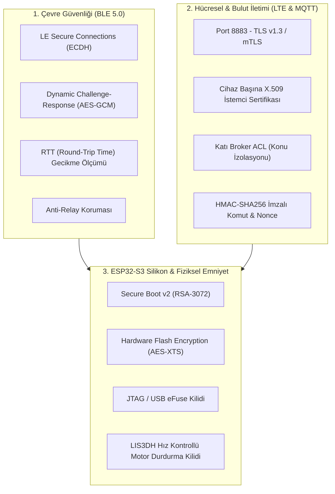

# AutoMoto — Firmware Güvenlik Şartnamesi (BLE, MQTT & Donanım Koruması)
## ESP32-S3 Tabanlı Keyless Go, Uzaktan Motor Kontrolü ve Telemetri Güvenlik Kılavuzu (v1.0)

Bu doküman; AutoMoto akıllı motosiklet telemetri ve güvenlik platformunun **firmware geliştirme sürecinde** uygulanması zorunlu olan Bluetooth Low Energy (BLE), MQTT bulut haberleşmesi, ESP32-S3 silikon düzeyindeki şifreleme ve fiziksel sürüş emniyeti kurallarını belirler.

---

## 1. Genel Güvenlik Mimarisi ve Tehdit Modeli

AutoMoto'da motor durdurma (Kill-Switch), kontak açma ve marş basma gibi fiziksel ve hayati fonksiyonlar yönetildiğinden; güvenlik açığı yalnızca veri sızıntısına değil, motosikletin çalınmasına veya seyir halindeki sürücünün can güvenliğinin tehlikeye girmesine yol açabilir.



---

## 2. BLE Keyless Go Güvenlik Mimarisi

### 2.1. ESP32-S3 Donanım Durumu ve Bilinen Açıkların Analizi
- **BrakTooth Muafiyeti (CVE-2021-28139):** Klasik Bluetooth (BR/EDR) katmanındaki uzaktan kod çalıştırma (RCE) açığıdır. **ESP32-S3'te Klasik Bluetooth bulunmaz; yalnızca BLE 5.0 donanımı vardır.** Bu nedenle çip seviyesinde BrakTooth sınıfındaki tüm açıklardan muaftır.
- **SweynTooth Açıkları (CVE-2020-13594 vb.):** Eski ESP-IDF sürümlerinde bozuk kanal haritalarıyla çipi kilitleten (DoS) açıklardır. Firmware katmanında **ESP-IDF v5.x** ve modern **Apache NimBLE** yığını kullanılarak bu açıklar tamamen elimine edilmelidir. Hantal ve geçmişte güvenlik açığı barındıran `Bluedroid` yığını **kullanılmamalıdır**.

### 2.2. Röle Saldırısı (Relay Attack) Koruması
Otomotiv anahtarsız giriş sistemlerinin en büyük zafiyeti; hırsızların RF sinyal uzatıcı (repeater) kullanarak uzaktaki telefonun BLE sinyalini motosiklete taşımasıdır. AutoMoto'da bu saldırıyı önlemek için 4 katmanlı doğrulama uygulanır:

1. **Salt RSSI Sinyal Gücüne Güvenilmez:**  
   Asla yalnızca `RSSI > -65 dBm` koşuluyla kontak açılmaz. Sinyal amfilerle yapay olarak yükseltilebilir.
2. **Dinamik Soru-Cevap (Challenge-Response):**  
   ESP32, yakındaki yetkili telefonu gördüğünde 16 baytlık rastgele bir `Nonce` üretir ve GATT üzerinden telefona gönderir.
3. **Zaman Damgalı İmzalı Token:**  
   Telefon mobil uygulaması bu `Nonce` değerini, aralarındaki gizli anahtarla (`Device_Secret`) ve geçerli UTC zaman damgasıyla imzalar:
   $$\text{Token} = \text{AES-128-GCM}(\text{Nonce} \parallel \text{Timestamp}, \text{Device\_Secret})$$
   ESP32'ye dönen token'ın süresi $\pm 5$ saniyeyi aşıyorsa işlem iptal edilir (Replay Koruması).
4. **Gidiş-Dönüş Süresi (RTT - Round Trip Time) Eşiği:**  
   Röle cihazları sinyali havadan alıp dijital olarak aktarırken kaçınılmaz olarak **30 – 100 ms ek gecikme** üretir.  
   ESP32, sorunun gönderilmesi ile cevabın alınması arasındaki mikrosaniye düzeyindeki süreyi ölçer:
   $$\Delta t = t_{\text{cevap}} - t_{\text{soru}}$$
   Eğer $\Delta t > 18\text{ ms}$ ise sinyal güçlü olsa dahi araya aktarıcı girdiği tespit edilir, kontak açılmaz ve sessiz alarm günlüğü tutulur.

### 2.3. BLE Eşleştirme (Pairing) Kuralları
- Savunmasız "Just Works" eşleştirme modu kesinlikle yasaktır.
- **LE Secure Connections (ECDH - Eliptik Eğri Diffie-Hellman)** kullanılacaktır.
- İlk eşleştirme; cihaz kutusunda/kart üzerinde basılı tekil dinamik PIN veya QR kod taranarak Out-Of-Band (OOB) veya Passkey Entry ile yapılacaktır. Havadan anahtar dinlenmesi (Sniffing) engellenir.

---

## 3. MQTT & Bulut İletişim Güvenlik Mimarisi

### 3.1. Taşıma Katmanı (mTLS - Mutual TLS)
- Standart şifresiz Port 1883 firewall üzerinde kalıcı olarak engellenecektir. Yalnızca **Port 8883 (MQTTS)** üzerinden bağlantı kurulur.
- **Çift Yönlü İstemci Sertifikası (mTLS):**  
  Her cihaza üretim aşamasında özel bir x.509 istemci sertifikası (`client.crt`) ve gizli anahtar (`client.key`) yüklenir.  
  Elinde yetkili Root CA tarafından imzalanmış geçerli sertifikası olmayan hiçbir harici istemci MQTT broker ile TCP el sıkışması dahi yapamaz.

### 3.2. Katı Erişim Listesi (ACL - Access Control List)
Broker yapılandırmasında (EMQX / Mosquitto) `allow_anonymous = false` kuralı zorunludur.  
Cihaz kimliği `{device_id}` (Örn: `ESP32_A8B6C4`) olan bir kart için izin verilen konular sınırlandırılmıştır:

```text
# SADECE YAZABİLİR (Publish):
automoto/{device_id}/telemetry
automoto/{device_id}/events
automoto/{device_id}/response

# SADECE DİNLEYEBİLİR (Subscribe):
automoto/{device_id}/commands
```
Cihaz istemcilerine joker karakterler (`+`, `#`) kesinlikle yasaklanmıştır; hiçbir motosiklet bir başka motosikletin telemetrisini veya komutlarını dinleyemez.

### 3.3. Uygulama Seviyesi Komut Güvenliği (Anti-Tamper & Anti-Replay)
TLS tüneli bir şekilde sonlandırılsa veya sunucu proxy'si ele geçirilse dahi, fiziksel röleleri tetikleyen komutlar doğrudan icra edilmez:

1. **Komut Paketi Formatı:**
   ```json
   {
     "cmd_id": "req-98214",
     "action": "REMOTE_START",
     "ts": 1776601240,
     "nonce": "e8f7a1c0d45b",
     "params": {
       "crank_ms": 1200
     },
     "signature": "a1b2c3d4..."
   }
   ```
2. **HMAC-SHA256 İmzası:**  
   $$\text{Signature} = \text{HMAC\_SHA256}(\text{cmd\_id} \parallel \text{action} \parallel \text{ts} \parallel \text{nonce}, \text{Secret\_Key})$$
3. **Zaman Damgası Kontrolü:** Sunucu ve ESP32 UTC saati karşılaştırılır; saat farkı $\pm 15$ saniyeden eskiyse paket atılır.
4. **Nonce Belleği:** Son icra edilen 50 adet `cmd_id` ve `nonce` ESP32 RTC/RAM belleğinde tutulur; mükerrer gelen kopyalar (Replay Attack) derhal imha edilir.

---

## 4. ESP32-S3 Silikon ve Donanım Düzeyi Güvenlik

Motosikletin selesi açılarak devre kartına fiziksel müdahale yapılması senaryosuna karşı ESP32-S3 donanımsal güvenlik modülleri aktif edilmelidir:

| Güvenlik Modülü | Mekanizma | Koruduğu Risk |
|---|---|---|
| **Secure Boot v2** | RSA-3072 imzalı bootloader doğrulaması | Karta sahte/zararlı firmware yüklenmesini engeller. |
| **Flash Encryption** | AES-128/256-XTS donanımsal şifreleme | Flaş bellek sökülüp okunsa dahi sertifikalar ve anahtarlar anlamsızdır. |
| **eFuse Disabling** | `DIS_PAD_JTAG`, `DIS_USB_JTAG`, `DIS_DOWNLOAD_MODE` bitleri | USB/JTAG üzerinden firmware ve bellek okuma portlarını kalıcı olarak yakar/kapatır. |
| **Hardware HMAC / DS**| Donanımsal Dijital İmza (Digital Signature) Çevrebirimi | Özel anahtarların RAM'e çıkarılmadan donanım içinde güvenle hesaplanmasını sağlar. |

---

## 5. Fiziksel Emniyet Kilitleri (Fail-Safe Logic)

Yazılım katmanında meydana gelebilecek tüm mantıksal hatalar veya yetkisiz komutlar, donanımsal güvenlik kuralları ile sınırlandırılmıştır:

1. **Hırsızlık & Gasp Anında 3 Aşamalı Akıllı Yumuşak Motor Durdurma (Smart Soft-Kill):**  
   - Uzaktan gelen `REMOTE_KILL` komutu yüksek hızda seyir halindeyken ana kontağı (`BTS7002`) küt diye kapatmaz (arka tekerlek kilitlenmesi ve kaza riski önlenir).
   - **1. Aşama (Soft-Cut Tork Düşürme):** `U12` Katı-Hal SSR (VO14642), yan ayak/ateşleme bobini hattını saniyede 15 ms aralıklarla darbeleyerek motor ateşlemesini atlatır. Motor teklemeden güç kaybeder; hırsız arıza çıktığını zannedip hızını kontrollü olarak 20 km/h altına çeker.
   - **2. Aşama (Akustik/Görsel Baskı):** Hız $<20\text{ km/h}$ olduğunda 110 dB piezo siren ve flaşörler son ses çalıştırılarak çevrenin dikkati hırsıza çekilir.
   - **3. Aşama (Sıfır Hızda Tam Kilit):** LIS3DH ivmeölçer ve GPS hızın sıfırlandığını ($V = 0\text{ km/h}$) teyit ettiği anda `BTS7002` ana kontağı kapatır ve marşı kilitler. Motor park pozisyonunda tamamen kilitli kalır.
2. **Boş Vites (Neutral) Kilidi:**  
   - Uzaktan marş basma (`REMOTE_START`) komutunda marş SSR rölesi (`U11`), optokuplör (`U9`) üzerinden okunan boş vites müşürüne mantıksal ve elektriksel olarak bağlıdır. Motosiklet vitesteyken marş motoruna kesinlikle enerji iletilmez.
3. **Varsayılan Güvenli Durum (Default Safe):**  
   - ESP32'nin enerjisi kesilirse veya kilitlenirse tüm katı-hal röleler (PROFET ve SSR'ler) normalde açık (Normally Open) konumda kalır.

---

## 6. Firmware Geliştirme Kontrol Listesi (Checklist)

- [ ] **SDK:** ESP-IDF v5.1+ (veya güncel PlatformIO ESP-IDF framework) seçildi.
- [ ] **BLE Stack:** `sdkconfig` üzerinden Bluedroid devre dışı bırakıldı, **Apache NimBLE** aktif edildi.
- [ ] **BT Classic:** ESP32-S3 mimarisinde kapalı olduğu teyit edildi.
- [ ] **mTLS:** Cihaza özel x.509 sertifika yükleme betiği hazırlandı.
- [ ] **ACL:** MQTT broker üzerinde topic izolasyonu kural dosyası yazıldı.
- [ ] **Flash Encryption & Secure Boot v2:** Seri üretim firmware imzalama anahtarları oluşturuldu.
- [ ] **eFuse Kilit Planı:** Seri üretime çıkışta JTAG/Download portlarını kapatacak eFuse betiği hazırlandı.
- [ ] **Anti-Relay & RTT:** BLE soru-cevap zamanlayıcısı mikrosaniye çözünürlüklü donanımsal timer (esp_timer) ile bağlandı.
