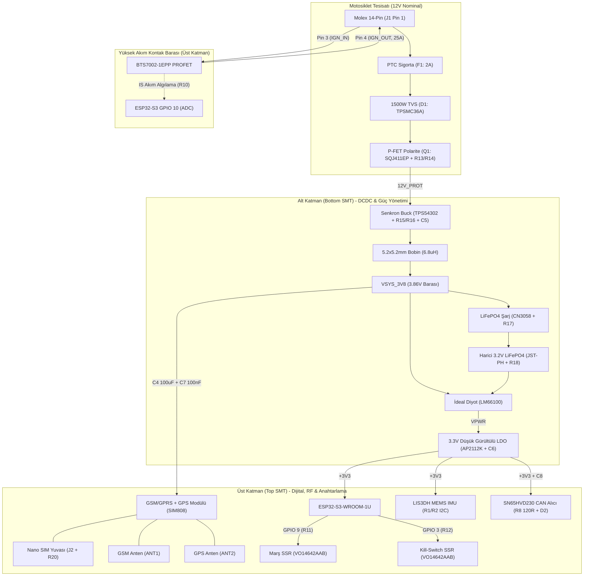

# AutoMoto Devre Kartı (PCB) ve Elektronik Şematik Teknik İmalat Şartnamesi
## SIM808 GSM/GPRS + GPS Entegreli, Katı-Hal (Solid-State) 4 Katmanlı Tasarım (v4.0)

Bu doküman; AutoMoto akıllı motosiklet telemetri, güvenlik, anahtarsız çalıştırma (Keyless Go) ve uzaktan emniyet kontrolü sisteminin mekanik rölelerden tamamen arındırılmış, modern katı-hal (`PROFET` / `SSR`) anahtarlama teknolojisine ve **SIMCom SIM808** (Quad-Band GSM/GPRS + Entegre GPS) hücresel modülüne dayanan, **80.0 mm x 55.0 mm** boyutlarındaki **ERC ve DRC %100 onaylı (0 İhlal, 0 Bağlanmamış Pin)** 4 katmanlı elektronik devre kartına (`automoto.kicad_pcb`) ve elektrik şemasına (`automoto.kicad_sch`) ait tüm mimari kararları, malzeme listesini (BOM), şematik yapılandırmayı, PCB katman ve iletken geometrisini, koordinatlı dizgi haritasını (CPL) ve imalat kurallarını içermektedir.

> [!NOTE]
> **CAD, Şematik, Doğrulama Raporları ve Görsel Doküman Bağlantıları:**
> - **KiCad 10 Elektrik Şematik Dosyası:** [automoto.kicad_sch](file:///home/sorcnr/Documents/automoto/hardware/pcb/automoto.kicad_sch)
> - **KiCad 10 Özel Sembol Kütüphanesi:** [automoto.kicad_sym](file:///home/sorcnr/Documents/automoto/hardware/pcb/automoto.kicad_sym)
> - **KiCad 10 4-Katmanlı PCB Tasarım Dosyası:** [automoto.kicad_pcb](file:///home/sorcnr/Documents/automoto/hardware/pcb/automoto.kicad_pcb)
> - **Şematik Üreteci Betiği:** [generate_kicad_sch.py](file:///home/sorcnr/Documents/automoto/hardware/pcb/generate_kicad_sch.py)
> - **PCB ve Otomatik Yönlendirme Üreteci Betiği:** [generate_kicad_pcb.py](file:///home/sorcnr/Documents/automoto/hardware/pcb/generate_kicad_pcb.py)
> - **ERC ve DRC Resmi Doğrulama Raporları:**
>   - [erc_report.rpt](file:///home/sorcnr/Documents/automoto/hardware/pcb/erc_report.rpt) (`Found 0 ERC violations`)
>   - [drc_report.rpt](file:///home/sorcnr/Documents/automoto/hardware/pcb/drc_report.rpt) (`Found 0 DRC violations, Found 0 unconnected pads, Found 0 Footprint errors`)
> - **2D Şematik ve PCB Çizimleri:**
>   - [drawings/automoto_schematic.pdf](file:///home/sorcnr/Documents/automoto/hardware/pcb/drawings/automoto_schematic.pdf) | [drawings/automoto_schematic.png](file:///home/sorcnr/Documents/automoto/hardware/pcb/drawings/automoto_schematic.png) | [drawings/automoto.svg](file:///home/sorcnr/Documents/automoto/hardware/pcb/drawings/automoto.svg)
>   - [drawings/automoto_pcb.png](file:///home/sorcnr/Documents/automoto/hardware/pcb/drawings/automoto_pcb.png) | [drawings/automoto_pcb.svg](file:///home/sorcnr/Documents/automoto/hardware/pcb/drawings/automoto_pcb.svg)
> - **3D Raytracing Renderları:**
>   - [renders/kicad_3d_isometric.png](file:///home/sorcnr/Documents/automoto/hardware/pcb/renders/kicad_3d_isometric.png) (İzometrik Perspektif)
>   - [renders/kicad_3d_top.png](file:///home/sorcnr/Documents/automoto/hardware/pcb/renders/kicad_3d_top.png) (Üst Yüzey: ESP32-S3, SIM808 GSM+GPS, BTS7002 PROFET, SSR, LIS3DH IMU, Molex 14P, USB-C)
>   - [renders/kicad_3d_bottom.png](file:///home/sorcnr/Documents/automoto/hardware/pcb/renders/kicad_3d_bottom.png) (Alt Yüzey: TPS54302 Buck, CN3058 LiFePO4 Şarj, LM66100 İdeal Diyot, AP2112K LDO, Nano SIM Yuvası)

---

## 1. v4.0 Revizyonunda Giderilen Tasarım Hataları ve Mimari İyileştirmeler

Önceki PCB revizyonunda tespit edilen tüm tasarım kusurları kökten giderilmiştir:
1. **Eksiksiz SIM808 GSM/GPRS + GPS Hücresel Entegrasyonu (`U2`):**
   - Önceki dosyada bağlantıları eksik bırakılan hücresel modül yerine **SIMCom SIM808** (`68-Pin LCC, 24.0 x 24.0 x 2.6 mm`) entegre edilmiştir.
   - Modülün tüm güç bacakları (`VBAT` Pins 54, 55, 56 -> `VSYS_3V8` + `C4` 100 µF tantal tampon + `C7` 100 nF dekuplaj), tüm analog/RF/dijital şase bacakları (`GND` Pins 2, 16, 30, 34, 45, 53, 57, 61, 62, 65), UART haberleşme hatları (`TXD` Pin 68, `RXD` Pin 67), donanımsal kontrol hatları (`PWRKEY` Pin 48 + `R19` 4.7 kΩ, `STATUS` Pin 52), **Nano SIM arayüzü** (`SIM_VDD` Pin 40, `SIM_DATA` Pin 41 + `R20` 10 kΩ pull-up, `SIM_CLK` Pin 42, `SIM_RST` Pin 43 -> `J2`) ve **çift RF anten çıkışı** (`GSM_ANT` Pin 60 -> `ANT1`, `GPS_ANT` Pin 64 -> `ANT2`) eksiksiz yönlendirilmiştir.
2. **Molex 14-Pin (`J1`) Delikleri Arasından Geçen Yolların Tamamen Kaldırılması:**
   - Pin deliklerine tehlikeli derecede yaklaşan veya iki pin sırası (`Row 1: Pins 1..7` ve `Row 2: Pins 8..14`) arasından geçen tüm yollar iptal edilmiştir.
   - `Row 1` (`Pins 1..7`) bağlantıları yalnızca üst yöne, `Row 2` (`Pins 8..14`) bağlantıları ise yalnızca alt yöne (`Pin 8` sola) çıkarılarak pin delikleri arasında **%100 bakırsız emniyet koridoru** bırakılmıştır.
3. **48 Bileşenli Tam Şematik ve PCB Senkronizasyonu (`0 ERC` / `0 DRC`):**
   - Şematikteki tüm pasif bileşenler (`R1..R20`, `C1..C8`, `L1`, `F1`, `D1..D3`) ve aktif entegreler (`U1..U12`, `Q1`, `Q5`) PCB'ye birebir aktarılmış; hiçbir bileşen atlanmamış ve `kicad-cli` ERC ile DRC kontrollerinden **0 hata, 0 uyarı, 0 bağlanmamış pad** ile geçmiştir.

---

## 2. Güç Dağıtım Şebekesi (PDN) ve Çift Yüzeyli (Double-Sided SMT) Mimari

Kartın iki yüzeyi, elektromanyetik uyumluluk (EMC), RF sinyal bütünlüğü ve termal izolasyon kriterlerine göre ayrılmıştır:

---

## 3. Kapsamlı Malzeme Listesi (Bill of Materials - BOM) — 48 Bileşen

| RefDes | Bileşen Adı / Model | Paket / Kılıf | Üretici | Katman | Temel Fonksiyon ve Parametreler |
|---|---|---|---|---|---|
| **U1** | ESP32-S3-WROOM-1U-N16R8 | SMD Modül (18.0x19.2 mm) | Espressif Systems | Top | Çift Çekirdek 240 MHz MCU, 16MB Flash, 8MB PSRAM, BLE 5.0 |
| **U2** | SIM808 | LCC-68 (24.0x24.0x2.6 mm) | SIMCom | Top | Quad-Band GSM/GPRS + Entegre 22-Kanal GPS/GNSS Alıcı Modülü |
| **U3** | LIS3DH | LGA-16 (3.0x3.0 mm) | STMicroelectronics | Top | 3 Eksen MEMS İvmeölçer (Sarsıntı ve Kaza/Devrilme Algılama) |
| **U4** | TPS54302DDCR | SOT-23-6 | Texas Instruments | Bottom | 4.5V-28V Giriş, 3.86V / 3A Senkron Step-Down Buck Regülatör |
| **U5** | CN3058E | HSOP-8-EP | Consonance | Bottom | 3.2V LiFePO4 Özel Şarj Entegresi (3.65V Kesme Gerilimi) |
| **U6** | LM66100DCKR | SC-70-6 | Texas Instruments | Bottom | Düşük Dirençli İdeal Diyot, Kesintisiz Güç Yolu (Power-Path) |
| **U7** | AP2112K-3.3TRG1 | SOT-23-5 | Diodes Inc. | Bottom | 3.3V / 600 mA Düşük Gürültülü LDO Regülatör |
| **U8** | SN65HVD230DR | SOIC-8 | Texas Instruments | Top | 3.3V CAN-Bus Alıcı-Verici (1 Mbps, Otomotiv OBD/Euro-5) |
| **U9** | LTV-356T | SOP-4 | Lite-On | Top | 3.75 kVrms Optokuplör (Boş Vites Müşürü Galvanik İzolasyonu) |
| **U10** | BTS7002-1EPP | PG-TSDSO-14-22 | Infineon | Top | Otomotiv Smart High-Side PROFET (2.6 mΩ, 21A Sürekli, IS Algılama) |
| **U11** | VO14642AAB | SMD-4 (SOP-4) | Vishay | Top | Opto-MOSFET Solid-State Röle (Marş Solenoid Tetikleme) |
| **U12** | VO14642AAB | SMD-4 (SOP-4) | Vishay | Top | Opto-MOSFET Solid-State Röle (Kill-Switch Emniyet Kesicisi) |
| **Q1** | SQJ411EP | PowerPAK SO-8 | Vishay | Bottom | P-Kanal MOSFET (-40V, 30A) Ters Polarite Koruması |
| **Q5** | DMN6075S | SOT-23 | Diodes Inc. | Top | N-Kanal MOSFET (60V, 2.5A) 110 dB Piezo Siren Sürücüsü |
| **D1** | TPSMC36A | DO-214AB (SMC) | Littelfuse | Bottom | 1500W Otomotiv TVS Geçici Gerilim Bastırıcı Diyot |
| **D2** | PESD2CAN | SOT-23 | Nexperia | Top | CAN-Bus (`CANH`/`CANL`) Çift Yönlü ESD Koruma Diyotu |
| **D3** | USBLC6-2SC6 | SOT-23-6 | STMicroelectronics | Top | USB Type-C (`D+`/`D-`/`VBUS`) ESD Koruma Entegresi |
| **F1** | 1812L200PR | SMD 1812 | Littelfuse | Bottom | 2A Tutma / 4A Atma Akımlı PTC Polimer Sigorta |
| **L1** | IHLP-2020BZ-01 (6.8 µH) | SMD 5.2x5.2 mm | Vishay | Bottom | 6.8 µH Korumalı Güç İndüktörü (4.5A Doyum Akımı) |
| **C1, C2** | 22 µF 50V X7R | SMD 1210 | Murata | Bottom | TPS54302 Buck Giriş Filtre Kapasitörleri (`12V_PROT`) |
| **C3** | 47 µF 10V X7R | SMD 1210 | Murata | Bottom | TPS54302 Buck Çıkış Filtre Kapasitörü (`VSYS_3V8`) |
| **C4** | 100 µF 6.3V Tantal | EIA-7343 (D Kılıf) | KEMET | Bottom | SIM808 2A GSM RF Burst Tepe Akımı Tampon Kapasitörü |
| **C5** | 100 nF 50V X7R | SMD 0603 | Yageo | Bottom | TPS54302 `BOOT`-`SW` Yüksek Taraf Sürücü Kapasitörü |
| **C6** | 1 µF 16V X7R | SMD 0603 | Yageo | Bottom | AP2112K-3.3 Çıkış Dekuplaj Kapasitörü (`+3V3`) |
| **C7** | 100 nF 16V X7R | SMD 0603 | Yageo | Bottom | SIM808 `VBAT` Yüksek Frekans RF Dekuplaj Kapasitörü |
| **C8** | 100 nF 16V X7R | SMD 0603 | Yageo | Top | SN65HVD230 CAN Alıcı-Verici Dekuplaj Kapasitörü |
| **R1, R2** | 4.7 kΩ %1 | SMD 0603 | Yageo | Bottom | `I2C_SDA` ve `I2C_SCL` 3.3V Pull-Up Dirençleri |
| **R3** | 10 kΩ %1 | SMD 0603 | Yageo | Bottom | ESP32-S3 `CHIP_PU` (`EN`) Donanımsal Reset Pull-Up Direnci |
| **R4** | 10 kΩ %1 | SMD 0603 | Yageo | Top | `U9` Optokuplör Çıkışı (`SENSE_NEUTRAL`) Pull-Up Direnci |
| **R5, R6, R7**| 330 Ω %1 | SMD 0603 | Yageo | Top | `LED1` (Kırmızı), `LED2` (Mavi), `LED3` (Yeşil) Akım Sınırlama |
| **R8** | 120 Ω %1 | SMD 0603 | Yageo | Top | CAN-Bus (`CAN_H` - `CAN_L`) Hat Sonlandırma Direnci |
| **R9** | 5.1 kΩ %1 | SMD 0603 | Yageo | Top | USB Type-C `CC1`/`CC2` 5V Host Алgılama Pull-Down Direnci |
| **R10** | 1.2 kΩ %1 | SMD 0603 | Yageo | Top | BTS7002-1EPP `IS` Oransal Akım Algılama Şönt Direnci |
| **R11, R12** | 330 Ω %1 | SMD 0603 | Yageo | Top | `U11` (Marş SSR) ve `U12` (Kill-Switch SSR) LED Sürme Dirençleri |
| **R13** | 4.7 kΩ %1 | SMD 0603 | Yageo | Top | `U9` Boş Vites Optokuplör Giriş Akım Sınırlama Direnci |
| **R14** | 100 kΩ %1 | SMD 0603 | Yageo | Top | `Q1` Ters Polarite P-MOSFET Gate Bias Direnci |
| **R15, R16** | 100 kΩ / 18 kΩ %1 | SMD 0603 | Yageo | Bottom | TPS54302 `FB` Gerilim Bölücü ($V_{\text{out}} = 3.86\text{ V}$) |
| **R17** | 2.0 kΩ %1 | SMD 0603 | Yageo | Bottom | CN3058 `ISET` Şarj Akımı Programlama Direnci |
| **R18** | 10 kΩ NTC / %1 | SMD 0603 | Yageo | Bottom | CN3058 `TEMP` Sıcaklık İzleme Referans Direnci |
| **R19** | 4.7 kΩ %1 | SMD 0603 | Yageo | Top | SIM808 `PWRKEY` Kontrol Hattı Seri Sürücü Direnci |
| **R20** | 10 kΩ %1 | SMD 0603 | Yageo | Top | Nano SIM `SIM_DATA` (`SIM_VDD` Referanslı) Pull-Up Direnci |
| **J1** | Molex Micro-Fit 14P | R/A Through-Hole | Molex | Top | Ana Araç Tesisat Soketi (`Molex 43045-1400`) |
| **J2** | Push-Pull Nano SIM | SMD Soket | Molex | Bottom | Alt Yüzeyde Nano SIM Kart Yuvası |
| **J3** | JST-PH 2-Pin | R/A Through-Hole | JST | Bottom | 3.2V Harici LiFePO4 Batarya Soketi (`VBAT_LIFEPO4`) |
| **J4** | USB Type-C 16-Pin | SMD USB-C | GCT | Top | Yerel USB CDC/JTAG Programlama ve Telemetri Portu |
| **ANT1** | IPEX / U.FL | SMD 3x3 mm | Hirose | Top | SIM808 Quad-Band GSM/GPRS Harici Anten Konnektörü |
| **ANT2** | IPEX / U.FL | SMD 3x3 mm | Hirose | Top | SIM808 GPS/GNSS Harici Anten Konnektörü |
| **SW1, SW2** | 5.0x5.0 mm Buton | SMD 4-Pin | C&K | Top | Donanımsal Reset (`SW1`) ve Bootloader (`SW2`) Butonları |
| **LED1..3** | 0603 SMD LED | SMD 0603 | Everlight | Top | Alarm (Kırmızı), BLE (Mavi), GSM/MQTT (Yeşil) Durum LED'leri |
| **H1..H4** | M3 Montaj Delikleri | 3.2mm Delik / 6.0mm Pad | Standart | Both | 4 Köşede M3 Mekanik Sabitleme ve Şase (`GND`) Delikleri |

---

## 4. ESP32-S3 (`U1`) ve SIM808 (`U2`) Pin Eşleşmeleri

### 4.1. ESP32-S3-WROOM-1U (`U1`) Pin Dağılımı
| Pin No | Pin Adı | Net Adı | Bağlı Donanım Bloğu ve Fonksiyonu |
|---|---|---|---|
| **Pin 1, 2** | GND, 3V3 | `GND`, `+3V3` | Ana 3.3V Besleme ve Toprak |
| **Pin 3** | EN (CHIP_PU) | `ESP_EN` | `R3` (10 kΩ) Pull-Up + `SW1` Reset Butonu |
| **Pin 4** | IO4 | `IMU_INT1` | `U3` (LIS3DH) Sarsıntı Uyandırma Kesmesi |
| **Pin 5** | IO5 | `IMU_INT2` | `U3` (LIS3DH) Kaza / Devrilme Kesmesi |
| **Pin 6** | IO6 | `CAN_TX` | `U8` (SN65HVD230) CAN-Bus Veri Gönderme Hattı |
| **Pin 7** | IO7 | `CAN_RX` | `U8` (SN65HVD230) CAN-Bus Veri Alma Hattı |
| **Pin 8** | IO15 | `PROFET_DEN` | `U10` (BTS7002) Teşhis Yetkilendirme (`DEN`) |
| **Pin 10** | IO17 | `MODEM_TX` | `U2` (SIM808 `RXD` Pin 67) AT Komut İletim Hattı |
| **Pin 11** | IO18 | `MODEM_RX` | `U2` (SIM808 `TXD` Pin 68) AT Komut Alma Hattı |
| **Pin 12** | IO8 | `PROFET_IN` | `U10` (BTS7002 `IN`) 25A Kontak Açma/Kapama |
| **Pin 13** | IO19 | `USB_DM` | `D3` (USBLC6) üzerinden `J4` USB Type-C `D-` |
| **Pin 14** | IO20 | `USB_DP` | `D3` (USBLC6) üzerinden `J4` USB Type-C `D+` |
| **Pin 15** | IO3 | `SSR_KILL` | `R12` (330 Ω) üzerinden `U12` Kill-Switch SSR |
| **Pin 16** | IO46 | `LED_GSM` | `R7` (330 Ω) üzerinden `LED3` (Yeşil GSM Durum) |
| **Pin 17** | IO9 | `SSR_STARTER` | `R11` (330 Ω) üzerinden `U11` Marş SSR |
| **Pin 18** | IO10 | `PROFET_IS` | `U10` (BTS7002 `IS`) + `R10` (1.2 kΩ) Kontak Akım Ölçümü |
| **Pin 19** | IO11 | `SIREN_CTRL` | `Q5` (DMN6075S Gate) 110 dB Piezo Siren Sürücüsü |
| **Pin 20** | IO12 | `SENSE_NEUTRAL`| `U9` (LTV-356T) + `R4` (10 kΩ) Boş Vites Algılama |
| **Pin 23** | IO21 | `MODEM_STATUS` | `U2` (SIM808 `STATUS` Pin 52) Modem Çalışma Durumu |
| **Pin 24** | IO47 | `LED_ALARM` | `R5` (330 Ω) üzerinden `LED1` (Kırmızı Alarm) |
| **Pin 25** | IO48 | `LED_BLE` | `R6` (330 Ω) üzerinden `LED2` (Mavi BLE Keyless) |
| **Pin 27** | IO0 | `ESP_BOOT` | `SW2` Bootloader Butonu |
| **Pin 31** | IO38 | `MODEM_PWRKEY` | `R19` (4.7 kΩ) üzerinden `U2` (SIM808 `PWRKEY` Pin 48) |
| **Pin 38** | IO2 | `I2C_SCL` | `U3` (LIS3DH `SCL`) + `R2` (4.7 kΩ) Pull-Up |
| **Pin 39** | IO1 | `I2C_SDA` | `U3` (LIS3DH `SDA`) + `R1` (4.7 kΩ) Pull-Up |
| **Pin 40, 41**| GND, EPAD | `GND` | İç Toprak Düzlemine (`In1.Cu`) Doğrudan Termal Via Bağlantılı |

### 4.2. SIMCom SIM808 (`U2` — 68-Pin LCC) Pin Dağılımı
| SIM808 Pin | Pin Adı | Net Adı | Bağlantı ve Fonksiyon |
|---|---|---|---|
| **Pins 54, 55, 56**| `VBAT` | `VSYS_3V8` | 3.86V 3A Ana Hücresel Güç Barası (`C4` 100 µF + `C7` 100 nF) |
| **Pins 2, 16, 30, 34, 45, 53, 57, 61, 62, 65** | `GND` | `GND` | Çoklu RF, Analog ve Dijital Şase Bacakları (`In1.Cu` Düzlemi) |
| **Pin 48** | `PWRKEY` | `MODEM_PWRKEY_R` | `R19` (4.7 kΩ) üzerinden ESP32-S3 `IO38` Açma/Kapama |
| **Pin 52** | `STATUS` | `MODEM_STATUS` | ESP32-S3 `IO21` Modem Açık/Şebeke Durum Geri Bildirimi |
| **Pin 67** | `RXD` | `MODEM_TX` | ESP32-S3 `IO17` UART Veri Girişi |
| **Pin 68** | `TXD` | `MODEM_RX` | ESP32-S3 `IO18` UART Veri Çıkışı |
| **Pin 40** | `SIM_VDD` | `SIM_VDD` | `J2` Nano SIM Besleme Çıkışı (1.8V / 3.0V Otomatik) + `R20` |
| **Pin 41** | `SIM_DATA` | `SIM_DATA` | `J2` Nano SIM I/O Veri Hattı + `R20` (10 kΩ) Pull-Up |
| **Pin 42** | `SIM_CLK` | `SIM_CLK` | `J2` Nano SIM Saat Sinyali |
| **Pin 43** | `SIM_RST` | `SIM_RST` | `J2` Nano SIM Reset Sinyali |
| **Pin 60** | `GSM_ANT` | `GSM_RF` | `ANT1` U.FL Konnektörü (Kısa Empedans Kontrollü RF İzi) |
| **Pin 64** | `GPS_ANT` | `GPS_RF` | `ANT2` U.FL Konnektörü (Kısa Empedans Kontrollü RF İzi) |

---

## 5. 4 Katmanlı PCB Katman Yapısı (Stackup) ve İletken Geometrisi

| Katman No | KiCad Katmanı | Kalınlık | Bakır Ağırlığı | Katman Tipi ve Fonksiyonu |
|---|---|---|---|---|
| **L1 (Üst)** | `F.Cu` | 0.035 mm | 1.0 oz (35 µm) | SMD Modüller (`U1`, `U2`, `U3`, `U8..U12`), Kısa RF Hatları (`GSM_RF`, `GPS_RF`), 1.0 mm Güç Baraları |
| **Dielektrik 1** | Prepreg (FR4) | 0.200 mm | — | $\varepsilon_r = 4.4$, `F.Cu` RF ve Sinyal Hatları için `In1.Cu` Referans Düzlemi |
| **L2 (İç 1)** | `In1.Cu` | 0.035 mm | 1.0 oz (35 µm) | **%100 Kesintisiz Katı Toprak Düzlemi (`GND`)** — EMI Kalkanlama ve Düşük Empedanslı Dönüş Yolu |
| **Dielektrik 2** | Core (FR4) | 1.065 mm | — | Mekanik Rijitlik Sağlayan Ana FR4 Çekirdek |
| **L3 (İç 2)** | `In2.Cu` | 0.035 mm | 1.0 oz (35 µm) | Güç Dağıtım (`VSYS_3V8`, `+3V3`, `12V_PROT`) ve Kesişmesiz İç Sinyal Köprüleri |
| **Dielektrik 3** | Prepreg (FR4) | 0.200 mm | — | `In2.Cu` ile `B.Cu` Arası İzolasyon |
| **L4 (Alt)** | `B.Cu` | 0.035 mm | 1.0 oz (35 µm) | DCDC Buck (`U4`, `L1`), LiFePO4 Şarj (`U5`), İdeal Diyot (`U6`), LDO (`U7`), Giriş Koruması (`F1`, `D1`, `Q1`), Nano SIM (`J2`) |

### İletken İz Genişliği ve Boşluk Kuralları (Design Rules)
* **Yüksek Akım Kontak & 12V Hatları (`IGN_IN`, `IGN_OUT`, `12V_RAW`, `12V_PROT`, `SW_NODE`):** `1.00 mm` iz genişliği.
* **Orta Akım Hücresel & Sistem Güç Hatları (`VSYS_3V8`, `VPWR`, `VBAT_LIFEPO4`, `VBUS_5V`, `+3V3`, `SIREN_OUT`, `STARTER_OUT`, `KILL_A`, `KILL_B`):** `0.50 mm` iz genişliği.
* **RF Anten Hatları (`GSM_RF`, `GPS_RF`):** `0.50 mm` kısa doğrudan mikroşerit hat (`In1.Cu` referanslı).
* **Mantıksal Sinyal ve Veri Hatları:** `0.25 mm` iz genişliği, minimum `0.20 mm` izolasyon boşluğu.
* **Via Boyutları:** `0.60 mm` dış çap / `0.30 mm` matkap çapı (tüm SMD `GND` pedleri kendi özel via bağlantılarıyla doğrudan `In1.Cu` düzlemine iner).

---

## 6. Koordinatlı Dizgi Listesi (Pick-and-Place / CPL) — 80.0 mm x 55.0 mm (v4.0)

KiCad koordinat sisteminde (Sol-Üst köşe $(0.0, 0.0)$ referanslı) tüm 48 bileşenin milimetrik yerleşim tablosu:

| RefDes | Bileşen / Model | Katman | X (mm) | Y (mm) | Açı (°) | Fonksiyon ve Yerleşim Bölgesi |
|---|---|---|---|---|---|---|
| **H1** | MountingHole_3.2mm_M3 | Top | 5.0 | 5.0 | 0° | Sol-Üst M3 Şase Montaj Deliği |
| **H2** | MountingHole_3.2mm_M3 | Top | 75.0 | 5.0 | 0° | Sağ-Üst M3 Şase Montaj Deliği |
| **H3** | MountingHole_3.2mm_M3 | Top | 5.0 | 50.0 | 0° | Sol-Alt M3 Şase Montaj Deliği |
| **H4** | MountingHole_3.2mm_M3 | Top | 75.0 | 50.0 | 0° | Sağ-Alt M3 Şase Montaj Deliği |
| **U1** | ESP32-S3-WROOM-1U | Top | 19.5 | 24.5 | 0° | Sol-Orta Ana Mikrodenetleyici |
| **U2** | SIM808 (68-Pin LCC) | Top | 57.0 | 24.0 | 0° | Sağ-Orta GSM/GPRS + GPS Modülü |
| **U3** | LIS3DH (LGA-16) | Top | 36.5 | 22.0 | 0° | Kartın Geometrik Merkezinde MEMS İvmeölçer |
| **U8** | SN65HVD230DR (SOIC-8) | Top | 66.0 | 43.5 | 0° | Sağ-Alt CAN-Bus Alıcı-Verici |
| **U9** | LTV-356T (SOP-4) | Top | 12.5 | 43.5 | 0° | Sol-Alt Boş Vites Optokuplörü |
| **U10** | BTS7002-1EPP | Top | 33.5 | 34.5 | 0° | Molex Üzerinde 25A Kontak PROFET Anahtarı |
| **U11** | VO14642AAB (SMD-4) | Top | 49.5 | 45.0 | 90° | Marş Tetikleme Solid-State Röle |
| **U12** | VO14642AAB (SMD-4) | Top | 58.0 | 45.0 | 90° | Kill-Switch Solid-State Röle |
| **Q5** | DMN6075S (SOT-23) | Top | 40.5 | 34.5 | 90° | Piezo Siren Sürücü N-MOSFET |
| **D2** | PESD2CAN (SOT-23) | Top | 72.5 | 43.5 | 90° | CAN-Bus ESD Koruma Diyotu |
| **D3** | USBLC6-2SC6 (SOT-23-6) | Top | 36.5 | 11.5 | 0° | USB Type-C ESD Koruma Entegresi |
| **ANT1** | U.FL (`GSM_ANT`) | Top | 57.0 | 7.5 | 180° | SIM808 Pin 60 Üstünde GSM U.FL Soketi |
| **ANT2** | U.FL (`GPS_ANT`) | Top | 73.5 | 25.0 | 90° | SIM808 Pin 64 Sağında GPS U.FL Soketi |
| **J1** | Molex Micro-Fit 14P | Top | 22.0 | 47.0 | 0° | Alt Kenar Ana Araç Tesisat Konnektörü |
| **J4** | USB Type-C 16P | Top | 36.5 | 3.5 | 0° | Üst Kenar USB Type-C Konnektörü |
| **SW1** | Reset Butonu | Top | 5.0 | 18.0 | 0° | Sol Kenar Reset (`EN`) Butonu |
| **SW2** | Boot Butonu | Top | 5.0 | 32.0 | 0° | Sol Kenar Bootloader (`IO0`) Butonu |
| **LED1** | 0603 Kırmızı LED | Top | 14.0 | 5.5 | 0° | Sol-Üst Alarm Durum LED'i |
| **LED2** | 0603 Mavi LED | Top | 20.0 | 5.5 | 0° | Sol-Üst BLE Durum LED'i |
| **LED3** | 0603 Yeşil LED | Top | 26.0 | 5.5 | 0° | Sol-Üst GSM Durum LED'i |
| **U4** | TPS54302DDCR | Bottom | 19.5 | 30.5 | 0° | Alt Katman 3.86V / 3A Senkron Buck Regülatör |
| **L1** | 6.8 µH Güç İndüktörü | Bottom | 12.0 | 30.5 | 0° | Alt Katman Korumalı Güç Bobini |
| **C1, C2** | 22 µF 50V 1210 | Bottom | 26.5 | 29.0 / 33.0 | 90° | Buck Giriş Filtre Kapasitörleri |
| **C3** | 47 µF 10V 1210 | Bottom | 6.0 | 25.0 | 90° | Buck Çıkış Filtre Kapasitörü |
| **C4** | 100 µF Tantal 7343 | Bottom | 47.5 | 12.5 | 0° | SIM808 `VBAT` RF Tampon Kapasitörü |
| **U5** | CN3058E (HSOP-8) | Bottom | 21.0 | 12.5 | 0° | LiFePO4 Batarya Şarj Entegresi |
| **U6** | LM66100DCKR (SC-70-6) | Bottom | 28.5 | 12.5 | 0° | Kesintisiz Güç Yolu İdeal Diyotu |
| **U7** | AP2112K-3.3 (SOT-23-5) | Bottom | 38.5 | 12.5 | 0° | 3.3V Düşük Gürültülü LDO Regülatör |
| **J3** | JST-PH 2-Pin | Bottom | 13.5 | 12.5 | 0° | Harici 3.2V LiFePO4 Batarya Soketi |
| **F1** | 1812L200PR PTC | Bottom | 13.5 | 44.5 | 90° | Molex Pin 1 Altında 2A PTC Sigorta |
| **D1** | TPSMC36A (SMC) | Bottom | 13.5 | 38.5 | 0° | 1500W Otomotiv TVS Koruma Diyotu |
| **Q1** | SQJ411EP (SO-8) | Bottom | 23.5 | 38.5 | 0° | P-MOSFET Ters Polarite Koruması |
| **J2** | Nano SIM Soketi | Bottom | 57.0 | 25.0 | 0° | Alt Yüzeyde SIM808 Altında Nano SIM Yuvası |
| **C5..C8, R1..R20** | 0603 SMD Pasifler | Top / Bottom | Çeşitli | Çeşitli | 0°/90° | İlgili Entegrelerin Yanında Kısa İzli Yerleşim |
